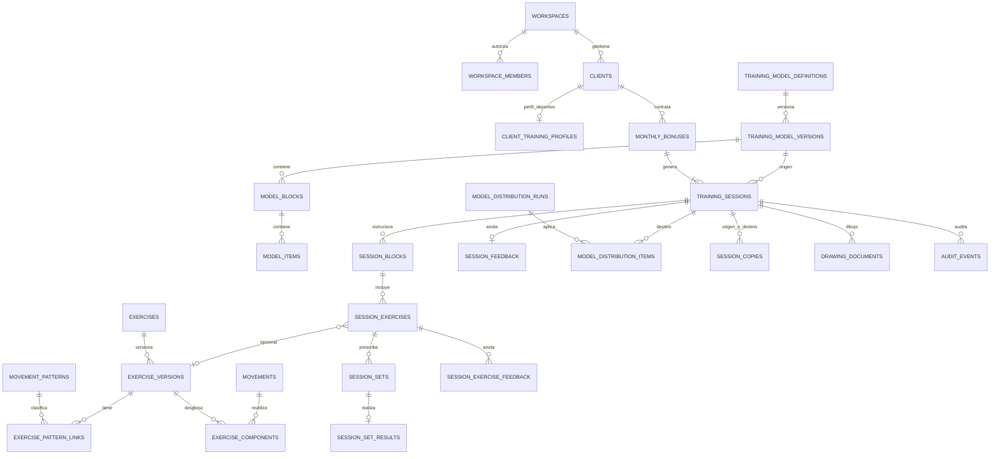

# Documento maestro unificado — App privada de gestión de entrenamientos

> **Versión:** 2.0 · 1 de noviembre de 2026  
> **Fuentes fusionadas:** `PLAN_APP_GESTION_ENTRENAMIENTOS.md` (arquitectura React Native/Expo, integración Lovable, datos y seguridad) y `Documento_maestro_app_entrenamientos_Beatriz_Sanz.docx` (requisitos funcionales y reglas de bonos/modelos).  
> **Uso:** especificación funcional y técnica inicial, base para implementación y pruebas con Codex.  
> **Usuaria operativa:** Beatriz Sanz; aplicación privada, **sin acceso de clientes ni de otros profesionales en el MVP**.  
> **Plataforma de la nueva aplicación:** **React Native + Expo + TypeScript para iOS y Android**, con prioridad de usabilidad en tablet. La web existente en **Lovable** es la fuente de clientes a integrar, no el framework de la nueva app.  
> **Estado:** especificación consolidada; conexión real con Lovable y opción de uso en navegador/desktop pendientes de validar.

## Criterio de fusión y precedencia

Se conservan **arquitectura, stack, capas, repositorio, integración, seguridad, pruebas y propuestas técnicas** del plan Markdown. Para la **lógica de negocio y flujo de trabajo de la entrenadora** prevalecen las reglas más detalladas del documento maestro adjunto. La posibilidad anterior de asignar sesiones a mano se conserva como **edición y personalización manual de cualquier sesión**; la **secuencia de modelos del bono** se asigna automáticamente. La biblioteca de ejercicios y movimientos pasa a ser **opcional y reutilizable**, nunca un requisito previo para introducir un ejercicio directamente en un modelo o sesión. Las divergencias y decisiones aún abiertas se enumeran al final, para evitar suposiciones implícitas.

---
## 0. Resumen ejecutivo

Herramienta privada para **planificar, versionar, individualizar y registrar** el entrenamiento de los clientes de Beatriz Sanz. La app obtiene o referencia los clientes de la web existente en Lovable. La entrenadora gestiona **bonos mensuales de 4, 8 o 12 sesiones**, cuyos **modelos A/B/C se distribuyen automáticamente con secuencias fijas**. Dentro de cada sesión **ella elige libremente** los ejercicios, las cargas, bandas, repeticiones, tempos y anotaciones, usando o no la biblioteca reutilizable.

Capacidades esenciales:

1. Consultar ficha del cliente, objetivos, nivel, limitaciones y observaciones (campos flexibles), respetando el origen de datos.
2. Crear/renovar bonos mensuales y generar automáticamente las sesiones A/B/C según el bono, siempre reiniciando en sesión 1.
3. Crear, editar, duplicar y versionar mensualmente **seis estructuras de modelo** (4-A; 8-A/B; 12-A/B/C).
4. Actualizar modelos distribuidos **para todos, solo nuevos o clientes elegidos**, protegiendo personalizaciones e históricos.
5. Escribir un ejercicio **directamente** en el modelo o sesión con solo un nombre; opcionalmente clasificar por patrones/planos/lateralidad, componer movimientos y guardar en biblioteca para reutilizar.
6. Distinguir **ejercicio combinado** (una sola entrada con varios movimientos) de **biserie/superserie** (varios ejercicios independientes en un mismo bloque).
7. Definir series, repeticiones, duración, descansos, peso en kg, tipo/color de goma, contracción (isométrica, concéntrica, excéntrica, balística, combinada) y tempo; registrar después los valores **reales** por separado.
8. Crear notas y dibujos editables con ratón, dedo o lápiz según dispositivo/plataforma; asociarlos a ejercicio, sesión o feedback.
9. Visualizar patrones trabajados y alternativas opcionales, **sin modificar automáticamente** la selección de ejercicios de la entrenadora.
10. Consultar por cliente/mes/bono el historial completo, incluidas sesiones no realizadas (cancelada, recuperable, perdida), copias recuperadas, cambios y feedback.

### Principios no negociables

- **Automatización de calendario estructural, no de criterio profesional:** la secuencia del bono se genera automáticamente; el contenido de ejercicios y sus modificaciones se decide manualmente.
- **Sin catalogación forzosa:** nombre del ejercicio obligatorio; el resto de atributos pueden omitirse salvo parámetros necesarios para la ejecución prescrita.
- **Independencia:** un cambio particular nunca modifica a otros clientes ni al modelo original.
- **Histórico fiable:** conservar estado, versión aplicada, lo planificado y lo realmente ejecutado; una copia no altera su origen.
- **Usabilidad práctica:** pocos pasos, composición y dibujo opcionales, acceso rápido a modelos previos, uso en móvil/tablet.
- **Privacidad:** únicamente la entrenadora; no crear cuentas de cliente, ni PDF ni IA que procese datos personales/sanitarios identificables.
## 1. Alcance funcional del MVP

| Área | Incluido | Expresamente fuera / límite |
|---|---|---|
| Acceso | Login privado para la usuaria autorizada, sesión segura | Registro público, cuentas de cliente y otros entrenadores |
| Clientes | Búsqueda, ficha, objetivos, nivel, limitaciones, histórico; referencia a Lovable | Duplicar innecesariamente el CRM existente |
| Bonos | Bonos mensuales **4/8/12**, secuencias fijas, generación, cierre y consulta histórica | Arrastrar automáticamente recuperables al bono siguiente |
| Modelos | Seis estructuras, versiones mensuales, copiar/editar, propagación controlada | Imponer un único ejercicio concreto por patrón |
| Ejercicios | Introducción directa mínima, composición opcional, patrones, lateralidad, posición y contracción | **Obligar** a crear biblioteca antes de programar |
| Biblioteca | Banco **opcional** de movimientos, ejercicios y material reutilizable; propuestas de variantes | Animación 3D automática y valoración biomecánica autónoma |
| Agrupaciones | Ejercicio combinado, biserie/superserie, bloques y HIIT intercalado | Forzar HIIT al final de sesión |
| Prescripción | Series, repeticiones/tiempo, descansos, pesos, gomas, tempos y anotaciones | Cálculo automático de cargas o equivalencia universal por color de goma |
| Asignación | Distribución automática del modelo por bono y **edición manual total por cliente** | Que el sistema elija por sí solo zancada, sentadilla o peso |
| Registro | Real vs planificado, sustituciones, sesiones realizadas/no realizadas, feedback y dibujos | Estado específico de sesión «parcialmente realizada» |
| Histórico | Filtrado, recuperación como copia, auditoría de cambios y conservación de versiones | Reescribir el pasado al editar una plantilla |
| Plataformas | App React Native iOS/Android; experiencia tablet | Web de gestión nueva garantizada sin validar viabilidad Expo Web |
| Exportación | Persistencia y consulta dentro de la app | Exportación PDF (no requerida) |

**Convivencia con la web existente:** Lovable sigue siendo la fuente comercial de clientes. La nueva app utiliza su propia interfaz móvil React Native y deberá poder comunicarse con ese origen por un canal autorizado; el mecanismo se decide tras la auditoría de integración.
## 2. Actores, permisos y perfil del cliente

### 2.1 Única usuaria del MVP

**Beatriz Sanz** es la entrenadora y única usuaria de la aplicación. Tiene permiso para consultar clientes autorizados, crear versiones de modelos, programar sesiones, distribuir cambios, guardar dibujos y registrar ejecuciones. No hay usuarios `client` autenticados ni roles multi-entrenador operativos en el MVP.

El modelo técnico mantiene `workspaces` y `workspace_members` para preservar permisos e independencia y facilitar una ampliación posterior; en la primera versión habrá un espacio de trabajo y una usuaria. No implementar complejidad de gestión multiempresa.

### 2.2 Ficha de cliente

- **Identificación mínima:** nombre, apellidos, código/ID estable procedente de Lovable y contacto si realmente se necesita.
- **Datos de entrenamiento:** objetivos, experiencia, nivel, características relevantes, limitaciones, lesiones y adaptaciones; campos libres y opcionales.
- **Actividad:** bono mensual actual, bonos anteriores, sesiones programadas/realizadas/no realizadas, ejercicios, cargas y feedback.
- **Protección:** la información sanitaria, cuando exista, requiere evaluación específica de base jurídica, acceso restringido, minimización y conservación apropiada. No enviarla a servicios de IA externos.

Se podrán mantener en tablas propias los **datos específicamente deportivos** no presentes en Lovable; la identidad comercial seguirá referenciada por `source_system` + `external_client_id`. No se sobrescribe la ficha fuente sin integración bidireccional explícita.

### 2.3 Permisos obligatorios

- Solo sesiones autenticadas con pertenencia activa al workspace pueden consultar y modificar datos.
- El bloqueo de pantallas con Expo Router **no sustituye** políticas SQL/RLS y Storage.
- Datos de un cliente, sus dibujos, modelos distribuidos y ejecuciones nunca se mezclan con los de otro.
- Claves privadas, credenciales de sincronización y `service_role` nunca aparecen en la aplicación móvil.
## 3. Stack recomendado

| Área | Tecnología | Motivo |
|---|---|---|
| Móvil | React Native + Expo + TypeScript | Una base de código iOS/Android y experiencia previa |
| Navegación | Expo Router | Flujo privado y rutas tipadas |
| UI | NativeWind + componentes propios | Velocidad de maquetación y consistencia; diseñar layouts tablet |
| Estado UI | Zustand | Editor, filtros, borradores no remotos |
| Datos servidor | TanStack Query | Caché, invalidaciones y mutaciones |
| Formularios | React Hook Form + Zod | Validaciones reutilizables |
| Editor de dibujo | `@shopify/react-native-skia` | Trazos, figuras y renderizado; exportación de previsualización |
| Persistencia | PostgreSQL en Supabase **si la integración lo permite** | Relaciones fuertes, integridad, SQL y JSONB |
| Auth | Supabase Auth para entrenadores, o federación verificada | Una sesión privada con control real de acceso |
| Archivos | Supabase Storage con buckets privados | Imágenes, dibujos exportados y multimedia |
| Lógica server | Funciones SQL/RPC o Supabase Edge Functions | Guardados atómicos y operaciones privilegiadas |
| Backend Node | **No en MVP**, salvo necesidad concreta | Evitar duplicar API y mantenimiento |
| Pruebas | Vitest (dominio), Jest + React Native Testing Library (UI), Maestro (E2E) | Cubrir reglas, vistas y flujos |
| Builds | EAS Build / Development Builds | iOS y Android, especialmente librerías nativas |

> No fijar versiones hasta inicializar el proyecto: usar la versión estable de Expo compatible con dependencias elegidas. Bloquear versiones en `package-lock.json`.

### 3.1 Límites del stack

- **Zustand no sustituye TanStack Query**; evitar duplicar datos remotos en stores.
- **Skia no produce automáticamente una postura corporal válida**; dibuja anotaciones sobre imagen o lienzo.
- **PostgreSQL no decide por sí mismo qué variante entrenar**; las propuestas salen de reglas explícitas y datos etiquetados.
- No llevar claves `service_role`, contraseñas ni secretos de sincronización al cliente móvil.


### 3.2 Acceso desde ordenador (no asumido en el MVP móvil)

El documento funcional original preveía una **web responsive, prioritaria para ordenador y tablet**, pero el requisito posterior del proyecto exige conservar **React Native**. Por tanto, iOS/Android son las plataformas comprometidas. Antes de prometer acceso desde un PC se realizará una **prueba técnica de Expo Web** (Skia, ratón, puntero/lápiz, persistencia y autenticación); si no cumple, se podrá construir un panel React web que comparta reglas TypeScript, Supabase y contratos de dominio. **No cambiar el stack principal a Lovable para la nueva app sin decisión explícita.**
## 4. Integración con la web Lovable (decisión bloqueante)

**No presuponer** que la web tiene un proyecto Supabase propio, ni modificar su base de datos antes de una auditoría.

### Escenario A — La web utiliza un Supabase propio

- Confirmar propiedad y acceso al proyecto desde el dashboard de Supabase.
- Localizar tablas reales: clientes, relaciones, autenticación, altas/bajas y campos identificadores.
- Reutilizar el proyecto si las políticas y responsabilidades están claras.
- Las tablas de entrenamiento se pueden crear en esquema propio (`training`) o en `public` controlado, tras estudiar exposición de Data API y permisos.
- Reutilizar usuarios existentes **solo si su sistema de Auth y autorización realmente coincide**. Los clientes de Lovable no requieren iniciar sesión en esta app.

### Escenario B — La web utiliza Lovable Cloud

- No hay acceso directo al dashboard de Supabase propietario ni a sus credenciales de base de datos.
- **No conectar la app móvil directamente a una URL o service key imaginada.**
- Evaluar, en este orden:
  1. API/Edge Function autorizada implementada en la web, si Lovable permite exponer el flujo necesario y autenticarlo de manera segura.
  2. Sincronización controlada mediante una interfaz autorizada que entregue solo los clientes necesarios.
  3. Migración planificada a un proyecto Supabase bajo control propio **solo si compensa**, validando identidad, datos y continuidad de la web existente.
- En caso de integración por API, el almacenamiento de entrenamientos puede vivir en un Supabase propio y `clients` ser un **espejo mínimo** con referencia externa estable.

### Contrato de integración recomendado

```ts
export interface ExternalClient {
  source: 'lovable_cloud' | 'supabase_owned' | 'external_api';
  externalId: string;       // ID estable en el sistema de origen
  displayName: string;
  email?: string | null;    // opcional; no importarlo si no hace falta
  active: boolean;
  updatedAt?: string | null;
}
```

**Reglas de sincronización:**

- `externalId` + `source` + workspace únicos; upsert idempotente.
- Si hay baja comercial, marcar inactivo; **no borrar rutinas o historial automáticamente**.
- El entrenador no modifica datos maestros del cliente desde esta app salvo integración bidireccional explícita.
- Registrar última sincronización, fallos y origen de cada cliente.
- Evitar crear una cuenta de Supabase Auth por cada cliente si este no va a iniciar sesión.
- Para una importación inicial, validación de duplicados y copia de seguridad antes de escribir.

**Entrega 0 obligatoria:** informe de esquema y método de conexión real de Lovable; decisiones aprobadas de sistema de autenticación, cliente fuente y residencia de datos.
## 5. Dominio funcional y terminología

### 5.1 Bono mensual (`monthly_bonus`)

Contrato de **4, 8 o 12 sesiones** asociado a un cliente y un periodo mensual. Tiene secuencia fija, estado de ciclo, número de sesión y referencia a los modelos/versiones elegidos al generarlo. El bono nuevo comienza en el índice 1, **sin heredar automáticamente sesiones del anterior**. Solo puede existir **un bono activo por cliente y mes**, salvo resolución explícita de negocio aún pendiente (ver §21).

### 5.2 Modelo estructural y versión mensual

Un **modelo** A, B o C define la **estructura de patrones/bloques** que toca en cada sesión. Hay seis combinaciones de `tipo_bono + letra`, no tres modelos globales intercambiables. Una **versión mensual** fija el contenido de un modelo en un periodo (ej.: `8-B / noviembre de 2026`), manteniendo accesibles las de meses previos. La entrenadora puede crear, editar, duplicar y recuperar modelos anteriores; la actualización de versiones distribuidas requiere elección de alcance y resolución de conflictos.

### 5.3 Patrón de movimiento

Clasificación orientativa para representar demandas de ejercicio: **core, empuje superior, tracción superior, dominante de rodilla, dominante de cadera, combinado, movilidad y HIIT**, que son las categorías del documento funcional. Se pueden añadir subcategorías técnicas útiles (bilateral/unilateral, empuje/tracción horizontal/vertical, rotación/antirrotación, etc.), **sin alterar las ocho etiquetas principales obligatorias para modelos**. Los patrones ayudan a revisar estímulos previos, pero no determinan por sí mismos el ejercicio siguiente.

### 5.4 Movimiento, ejercicio libre, ejercicio reutilizable

- **Movimiento:** componente opcional de composición (`base`, `modifier`, `additional`) como zancada, talón elevado, rebote o abducción.
- **Ejercicio libre de sesión/modelo:** se crea desde cualquier editor **sin pasar por biblioteca**. **Nombre obligatorio**, demás campos opcionales. Se guarda íntegramente en la sesión o en el modelo.
- **Ejercicio de biblioteca:** versión reutilizable e identificable que puede seleccionarse en varias sesiones; sus componentes, anotaciones y materiales se guardan de forma versionada.
- **Ejercicio combinado:** **una** entrada de ejercicio con varios componentes (zancada + press), y parámetros de un solo ejercicio. Distinto de una biserie.
- **Biserie/superserie:** **dos o más ejercicios independientes** reunidos en un bloque, con orden y rondas del grupo, pero prescripciones y resultados por ejercicio.

### 5.5 Clasificaciones opcionales del ejercicio

- **Patrón:** core / empuje superior / tracción superior / dominante de rodilla / dominante de cadera / combinado / movilidad / HIIT.
- **Lateralidad:** unilateral / bilateral / combinado / otros.
- **Plano o posición:** horizontal / vertical / sentado / tumbado / medio arrodillado / cuadrupedia / combinado.
- **Tipo de movimiento:** rotación / antirrotación / inclinación / flexión / extensión / giro / abducción / aducción / rebote / combinado.
- **Contracción:** isométrica / concéntrica / excéntrica / balística / combinada; técnicamente puede añadirse `convencional` cuando no hay énfasis.
- **Material:** ninguno, banda (color y marca si aplica), mancuernas, barra, hex bar, palo, discos u otros; varios materiales permitidos.

La falta de clasificación **no impide guardar un ejercicio**. Si se solicita una composición estructurada con movimientos, el editor puede pedir un movimiento base para esa **función concreta**, nunca para un ejercicio introducido libremente.

### 5.6 Bloque de entrenamiento

Contenedor ordenado dentro de un modelo o sesión. Representa un bloque común, un intervalo HIIT o una agrupación `superset`; guarda posición y, en biserie/superserie, número de rondas y descansos de bloque. El HIIT **puede intercalarse** entre bloques, no debe situarse siempre al final.

### 5.7 Sesión individual y prescripción

La sesión es un registro de una ocurrencia del bono para un cliente concreto. Tiene **letra de modelo asignada automáticamente**, número de sesión dentro del bono, versión de origen y una **copia independiente de bloques, ejercicios y parámetros**. El entrenador modifica a voluntad ejercicios, kg, bandas, tempo, orden, notas o dibujo **solo en esa copia**.

### 5.8 Ejecución, feedback y dibujo

- **Planificación**: intención inmutable a efectos históricos (con revisiones auditadas mientras está pendiente).
- **Ejecución real**: entrada separada que registra ejercicio, series, repeticiones, cargas, duración, sustituciones e incidencias.
- **Feedback general**: nota técnica, observación de sesión, posible esfuerzo percibido (opcional), y recomendación futura.
- **Feedback por ejercicio**: nota relacionada con un ejercicio de la sesión, dibujo si procede.
- **Dibujo**: documento vectorial editable más previsualización opcional; se vincula a versión de ejercicio/modelo, sesión o feedback y no modifica su origen.

### 5.9 Estados de sesión y cierre mensual

Estados de negocio **exactamente tres**: `pending` (Pendiente), `completed` (Realizada) y `not_completed` (No realizada). Cuando es `not_completed`, subtipo `cancelled` (Cancelada), `recoverable` (Recuperable) o `lost` (Perdida). **No existe estado `partial`**; los trabajos parcialmente realizados se explican mediante datos reales y notas, sin introducir otra categoría principal. `draft` puede ser un estado del **editor/plantilla**, no de la sesión emitida por el bono.
## 6. Reglas de negocio normativas

### 6.1 Bonos, secuencias y reinicio

| Bono | Secuencia exacta de sesiones | Modelos habilitados |
|---|---|---|
| **4 sesiones** | `A-A-A-A` | 4-A |
| **8 sesiones** | `A-B-A-B-A-B-A-B` | 8-A / 8-B |
| **12 sesiones** | `A-B-C-A-B-C-A-B-C-A-B-C` | 12-A / 12-B / 12-C |

**Composición estructural de los seis modelos:**

| Bono-modelo | Orden de patrones de la estructura |
|---|---|
| **4-A** | Core → dominante de rodilla → empuje superior → dominante de cadera → tracción superior → HIIT |
| **8-A** | Core → tracción superior → dominante de rodilla → HIIT |
| **8-B** | Core → empuje superior → dominante de cadera → HIIT |
| **12-A** | Core → dominante de rodilla → dominante de cadera → HIIT |
| **12-B** | Core → tracción superior → empuje superior → HIIT |
| **12-C** | Core → dominante de rodilla → empuje superior → dominante de cadera → tracción superior → HIIT |

La estructura representa **patrones por cubrir, no ejercicios obligatorios**. El editor permite reordenar bloques y **colocar HIIT intercalado** aunque la descripción textual lo liste al final; conservar la plantilla estructural de referencia para comparar la sesión concreta con el modelo. El orden exacto de bloques en cada versión lo decide la entrenadora.

- **BON-01:** crear bono para `client_id`, `period_month` (mes calendario) y tipo `4|8|12`; comprobar duplicados y conflictos antes de confirmar.
- **BON-02:** generar exactamente N sesiones y asignar la letra del modelo usando la secuencia anterior; la usuaria **no tiene que elegir letra** cada vez.
- **BON-03:** fijar automáticamente la **versión mensual aplicable** del modelo al generar cada sesión y guardar un snapshot editable por cliente.
- **BON-04:** al abrir un nuevo bono mensual, comenzar desde `session_number=1`; conservar los bonos y versiones anteriores. Nunca trasladar automáticamente una sesión recuperable.
- **BON-05:** una sesión del mes anterior no realizada queda en el histórico. En el cierre se cambia a `not_completed`; si su subtipo no está claro, se podrá marcar pendiente de clasificación administrativa **sin asignar arbitrariamente `lost`**.
- **BON-06:** cambiar tipo de bono cuando ya existen sesiones exige vista previa, confirmación y reglas de conservación; **no borrar realizaciones ni feedback**. El comportamiento preciso cuando existen sesiones completadas queda como decisión abierta (§21).
- **BON-07:** la creación/renovación es **transaccional e idempotente**, única por cliente/periodo. Se controla concurrencia desde servidor.
- **BON-08:** no se genera la secuencia por IA ni por frecuencia histórica: es **determinista**.

### 6.2 Gestión y actualización de modelos

- **MOD-01:** existen seis modelos estructurales; se pueden crear/duplicar/editar sus contenidos y guardar versiones mensuales con ejercicios escritos directamente en el editor.
- **MOD-02:** **nunca es obligatorio** elegir un ejercicio del catálogo antes de introducirlo. El nombre es el mínimo exigido; patrón, lateralidad, posición, material y contracción se completan cuando aporten valor.
- **MOD-03:** el modelo incluye bloques ordenados, ejercicios libres o referenciados, agrupaciones, parámetros por serie, notas y dibujos; puede tener versiones draft/published, sin sobrescribir versiones anteriores.
- **MOD-04:** al distribuir una versión actualizada, ofrecer exactamente tres alcances: **cambiar a todos** (sesiones pendientes afectadas), **cambiar solo a nuevos** (no tocar clientes existentes), **cambiar a clientes seleccionados** (lista explícita).
- **MOD-05:** antes de cualquier actualización de sesiones existentes mostrar **vista previa de clientes/sesiones**, número de cambios y conflictos con modificaciones individuales.
- **MOD-06:** las **sesiones completadas, no realizadas cerradas y registros reales** son inmunes a propagaciones; las versiones anteriores permanecen consultables.
- **MOD-07:** cada campo/bloque de sesión guarda origen y personalización (`origin_model_item_id`, `origin_revision`, `is_overridden` o mapa de overrides), para no sobrescribir cambios particulares sin aviso.
- **MOD-08:** resolución de conflictos individual o por conjunto: **conservar valor del cliente**, **aplicar nuevo valor** o **excluir sesión de esta actualización**. Sin elección explícita, no modificar campos conflictivos. La interfaz debe permitir revisar un diff.
- **MOD-09:** la operación masiva será transaccional por sesión, reintentable, con auditoría e informe final; nunca propagar parcialmente sin registro.
- **MOD-10:** `cambiar solo a nuevos` significa crear/publicar nueva versión para **asignaciones futuras**, sin modificar sesiones generadas.

### 6.3 Ejercicios y movimientos

- **EX-01:** crear un ejercicio en sesión/modelo requiere únicamente un nombre no vacío (sin catalogación forzosa).
- **EX-02:** el ejercicio **puede** enlazar una versión de biblioteca y/o componentes de movimiento; los enlaces no son obligatorios.
- **EX-03:** si se declara composición estructurada, el editor puede requerir una base para publicar **esa composición**; los otros componentes tienen rol, posición, modo y grupo simultáneo/secuencial.
- **EX-04:** un ejercicio combinado se guarda como **una** entrada; una biserie/superserie guarda **dos o más entradas y una agrupación** que almacena rondas/orden. Nunca tratarlos como sinónimos.
- **EX-05:** las categorías de patrón, lateralidad, posición, movimiento y contracción son editables/optativas; las versiones de modelo sí contienen sus **slots de patrones estructurales**.
- **EX-06:** se pueden archivar ejercicios/movimientos reutilizables, sin borrar referencias históricas; una modificación de biblioteca crea nueva versión, no reescribe sesiones.
- **EX-07:** permitir añadir/sustituir manualmente ejercicios independientemente del patrón sugerido, guardando la clasificación final si se indica.
- **EX-08:** material múltiple permitido; en banda registrar **color como campo específico**; marca/modelo/nivel o resistencia nominal opcional y sin inferencia automática por color.

### 6.4 Cargas, tempo y contracción

- **PRE-01:** series/repeticiones, duración, descanso, carga y tempo pueden especificarse por bloque, ejercicio o serie; la serie prevalece si se particulariza.
- **PRE-02:** peso en `numeric` kg con significado `total|per_hand|per_side|additional`; bandas por referencia o por tipo/color libre en la sesión para no bloquear edición.
- **PRE-03:** carga en kg, banda, peso corporal u otra; varias cargas compatibles en el mismo ejercicio mediante componentes adicionales de carga.
- **PRE-04:** foco de contracción `conventional|eccentric|isometric|concentric|ballistic|combined`, con tempo por fases `eccentric-bottomPause-concentric-topPause` cuando corresponda.
- **PRE-05:** la isometría admite `hold_seconds` sin obligar a indicar repeticiones; se admiten combinaciones de isometría con fases dinámicas.
- **PRE-06:** los datos reales nunca sustituyen los planificados. Ejemplo: plan 3×10 a 12 kg, real 3×8 a 10 kg.
- **PRE-07:** validar negativos, rangos y unidades; `NULL` cuando no aplica, sin rellenar automáticamente cero.

### 6.5 Estados, ejecución y cierre

- **SES-01:** toda sesión emitida por bono nace `pending` y con número dentro del bono; una sesión adicional manual debe vincularse expresamente a bono/mes o anotarse como extraordinaria (decisión del MVP: permitir extraordinaria con etiqueta, sin cambiar la secuencia del bono).
- **SES-02:** estados principales únicamente `pending`, `completed`, `not_completed`; `not_completed_reason` admite `cancelled|recoverable|lost` y no se usa en otras situaciones.
- **SES-03:** resultado parcial se registra en `session_set_results` y `session_feedback`/observaciones, **no con `partial` como estado**.
- **SES-04:** no se marca completada sin acción explícita de la entrenadora; registrar `completed_at` y autor.
- **SES-05:** a final de mes, pendientes del bono antiguo pasan a `not_completed` conservando o solicitando clasificación; no se arrastran al nuevo bono.
- **SES-06:** recuperar una sesión histórica **siempre crea una copia nueva** con `copied_from_session_id`, y no modifica original, incluidos dibujos y ejecución.
- **SES-07:** conservar snapshots y revisiones de lo planificado; las ejecuciones reales y feedback se guardan separadamente.
- **SES-08:** las fechas del bono son `date` de calendario y los instantes de registro `timestamptz` UTC, con presentación en la zona local elegida.
- **SES-09:** reabrir/corregir sesión cerrada solo mediante una acción auditada y sin sobrescribir silenciosamente su histórico.

### 6.6 Dibujos, anotaciones y feedback

- **ANN-01:** dibujo integrado con lápiz, color, borrador, deshacer/rehacer, limpiar y guardar; usar ratón o stylus si la plataforma lo admite, táctil en móvil/tablet.
- **ANN-02:** guardar **JSON vectorial editable**, resolución/base de referencia, trazos y formas; previsualización PNG/WebP opcional en almacenamiento privado.
- **ANN-03:** vincular anotaciones a ejercicio, sesión o nota de feedback. Copiar un entrenamiento copia sus dibujos sin crear edición compartida accidental.
- **ANN-04:** notas técnicas del modelo/ejercicio y feedback de ejecución pertenecen a ámbitos distintos y se preservan por versión.
- **FB-01:** feedback general y por ejercicio, incidencias, recomendaciones futuras y cambios de carga o sustitución; RPE/valoración técnica opcionales, nunca obligatorios.
- **FB-02:** registrar identidad/fecha de cada cambio relevante y acceder a todo desde el historial.

### 6.7 Patrones y propuestas informativas

- **PAT-01:** recuperar fecha, versión, ejercicios y cargas de sesiones completadas; incluir no realizadas solo cuando se consulta el historial general, no como estímulo completado.
- **PAT-02:** tras sentadilla puede proponerse zancada; tras back squat front squat/hex bar, según clasificación; **todas las alternativas son sugerencias revisables**.
- **PAT-03:** el sistema nunca impone variar patrón ni reemplazar ejercicio, carga o material. Las secuencias automáticas solo indican **qué modelo estructural toca**.
- **PAT-04:** si faltan etiquetas de patrón, mostrar `sin clasificar` y permitir corrección manual, sin inventar biomecánica.

### 6.8 Consistencia de datos y seguridad

- **INT-01:** aislamiento por cliente y workspace; FKs compuestas/RPC cuando proceda.
- **INT-02:** versiones publicadas, sesiones completadas y snapshots son históricos; no aplicar cambios retroactivos silenciosos.
- **INT-03:** auditoría de cambios masivos, revisiones, cancelaciones, cierres y reaperturas; idempotencia de generación.
- **INT-04:** no utilizar datos personales/sanitarios identificables en IA externa, logs públicos, capturas de pantalla de pruebas ni telemetría.
## 7. Flujos de negocio detallados

### Flujo A. Alta/renovación de bono mensual

1. Abrir cliente → `Bonos` → nuevo mes; verificar si ya existe uno.
2. Seleccionar **4/8/12 sesiones** (elección manual del tamaño de bono).
3. Mostrar secuencia calculada y versiones mensuales A/B/C que se aplicarán.
4. Confirmar; una **única transacción** crea `monthly_bonus`, 4/8/12 sesiones `pending` y snapshots independientes de los modelos.
5. Permitir añadir fecha individual a cada sesión y personalizar ejercicios/cargas sin cambiar su letra A/B/C.
6. Guardar referencia a versión/modelo de origen; reintentar la operación no duplica nada.

### Flujo B. Crear/editar modelo mensual

1. Elegir uno de los **seis tipos** `4-A`, `8-A`, `8-B`, `12-A`, `12-B`, `12-C`.
2. Duplicar un mes anterior o comenzar con sus **slots estructurales** predefinidos.
3. Editar bloques, introducir ejercicios por **nombre libre** o seleccionar biblioteca, crear biseries/superseries, añadir HIIT intercalado, cargas y notas.
4. Añadir dibujo y guardar borrador; publicar una versión mensual inmutable.
5. Si ya se distribuyó una versión previa, elegir **todos / solo nuevos / seleccionados**, revisar vista previa y resolver conflictos.

### Flujo C. Ejercicio directo y composición opcional

1. En el editor del modelo o sesión, pulsar `Añadir ejercicio` y escribir su **nombre**. Ya es válido guardarlo.
2. Opcional: elegir patrón (core/rodilla/cadera/etc.), lateralidad, plano, tipo de movimiento, contracción y material.
3. Opcional: componer un ejercicio con zancada + talón elevado + rebote + abducción de hombro, indicando simultaneidad o secuencia.
4. Opcional: introducir color de banda o kg, series, tiempo, descanso, tempo y notas/dibujo.
5. Opcional: `Guardar también en mi biblioteca` para reutilizarlo; **esta acción nunca es obligatoria**.
6. Si son **dos ejercicios separados en biserie**, agregarlos al bloque `superset` y definir rondas: no convertirlos en un ejercicio combinado.

### Flujo D. Personalizar sesión de cliente

1. Abrir cliente → bono del mes → sesión N y letra asignada automáticamente.
2. Consultar modelo usado, última sesión real y patrones recientes.
3. Elegir ejercicios concretos (por ejemplo, sentadilla vs zancada, back vs front squat, hex bar) y configurar kilos/gomas/tempo.
4. Guardar cambios **solo en la sesión de este cliente**. Marcar origen/override para futuras actualizaciones.
5. No se cambia el bono, ni el número, ni la letra A/B/C al variar un ejercicio.

### Flujo E. Actualización distribuida de un modelo

1. Publicar nueva versión mensual o revisión del modelo.
2. Seleccionar alcance: **todos pendientes**, **solo futuros**, **clientes elegidos**.
3. Calcular diff por `model_item_id`/campo y listar sesiones afectadas, excluidas y conflictos.
4. En personalizaciones de cliente, decidir `conservar personalización`, `aplicar nuevo valor` o `excluir sesión`.
5. Confirmar. Ejecutar en servidor con control de revisión/permiso, registro de auditoría e informe.
6. Verificar que sesiones realizadas y su `actual`/feedback permanecen intactas.

### Flujo F. Registrar la ejecución de una sesión

1. Abrir sesión pendiente; consultar planificación.
2. Anotar ejercicios efectivamente realizados, series, repeticiones, carga, duración, cambios/sustituciones e incidencias.
3. Añadir feedback general, nota/dibujo por ejercicio y recomendaciones si procede.
4. Finalizar marcando `completed` o `not_completed` y, en este último caso, motivo adecuado; si la ejecución fue parcial, anotarlo en resultados/observaciones sin un cuarto estado.
5. Consultar prescripción y realizado **lado a lado** en cualquier momento posterior.

### Flujo G. Cierre de mes y recuperación

1. Identificar bonos del periodo que termina y sus sesiones `pending`.
2. Marcar esas sesiones `not_completed` con subtipo (si se desconoce, pendiente de clasificar; nunca asumir perdida).
3. Conservar bonos anteriores, modelos, versiones y dibujos.
4. Crear siguiente bono → reiniciar siempre en sesión 1 con nueva secuencia; **no arrastrar** recuperables.
5. Para recuperar el contenido de una sesión anterior, ejecutar `Duplicar para nueva planificación`; se crea una **copia independiente** que no alterará el bono histórico. Si debe consumir una sesión del nuevo bono, el entrenador **elige explícitamente qué sesión destino sustituir**.

### Flujo H. Consultar historial y seguimiento

- Filtros por cliente, periodo, tipo de bono, modelo, número y estado.
- Vista: versión de modelo utilizada, planificación original, cambios individuales, ejecutado, dibujo, feedback e historial de actualizaciones.
- Opción `Copiar para próxima sesión` sin modificación retroactiva.
## 8. Navegación, pantallas y experiencia de uso

```text
App React Native privada
├── Autenticación
├── Dashboard
│   ├── Bonos activos y a renovar
│   ├── Sesiones pendientes / realizadas / no realizadas
│   └── Accesos a modelos, clientes e historial
├── Clientes
│   ├── Búsqueda y listado
│   └── Ficha del cliente
│       ├── Datos personales mínimos
│       ├── Objetivos, nivel, limitaciones y observaciones
│       ├── Bonos mensuales (4/8/12)
│       ├── Planificación del mes (N y A/B/C)
│       ├── Historial y feedback
│       └── Recuperar / duplicar sesión
├── Modelos
│   ├── Seis estructuras del bono
│   ├── Versiones mensuales / duplicar / recuperar
│   ├── Editor de bloques y ejercicios libres
│   └── Distribuir actualización (todos / nuevos / seleccionados)
├── Editor de sesión / ejercicio
│   ├── Patrón, lateralidad, plano, tipo, contracción (opcionales)
│   ├── Ejercicio libre o compositor de movimientos
│   ├── Agrupación biserie / superserie / HIIT
│   ├── Series, carga, banda, tempo y descanso
│   ├── Notas y lienzo de dibujo
│   └── Prescrito frente a realizado
├── Biblioteca opcional
│   ├── Movimientos, patrones y material
│   └── Ejercicios reutilizables
├── Histórico y cambios
│   ├── Búsqueda por cliente/mes/modelo/estado
│   └── Auditoría y recuperación por copia
└── Cuenta, seguridad e integración Lovable
```

**Prioridad de UX:** desde la ficha del cliente, llegar a la sesión actual en pocos toques; crear un ejercicio **sin introducir etiquetas**; controles de carga con teclado numérico; edición de bloques sin perder borrador; dibujos táctiles en tablet y móviles. Para ratón/escritorio realizar prueba técnica antes de comprometer soporte web; no eliminar el requisito funcional de poder dibujar con ratón cuando exista una interfaz web futura.
## 9. Arquitectura de datos

### 9.1 Relacional + JSONB selectivo

- **Relacional:** clientes, perfiles deportivos, bonos, modelos y versiones, bloques y agrupaciones, sesiones generadas, ejercicios de sesión, movimientos, equipos, series, resultados, dibujos, actualizaciones y auditoría.
- **JSONB:** parámetros extendidos, trazos vectoriales del dibujo, snapshots auxiliares, mapas de cambios de overrides. No almacenar todas las sesiones como un JSON opaco.
- **Separar modelo reutilizable → sesión individual → ejecución real** y mantener `origin_*` más snapshots para trazabilidad.
- **La biblioteca es facultativa:** un ejercicio libre puede no tener referencia de `exercise_versions`, pero sí debe tener `name_snapshot` válido.
- **La secuencia A/B/C es un invariante de bono**, no un efecto accidental de la UI.

### 9.2 Entidades y relaciones (visión simplificada)



> El diagrama omite enlaces accesorios y la alternativa de tablas de plantillas generales para mantener la lectura. Las relaciones `training_model_definitions` / versiones y `monthly_bonuses` / sesiones son la **ruta normativa del MVP**; `routine_templates` sigue disponible para plantillas ad hoc futuras pero no sustituye estos modelos A/B/C.
## 10. Modelo de datos PostgreSQL — diccionario

**Convenciones:** PK `uuid`, `created_at` / `updated_at` `timestamptz`, `workspace_id` en entidades de propiedad, `deleted_at` o `archived_at` cuando corresponda; UUIDs generados con `gen_random_uuid()`. Todas las FKs deben respetar pertenencia al workspace mediante validación SQL/RPC o restricciones compuestas. Las entidades de origen externo usan `external_id text`, aunque los registros del nuevo sistema son UUID locales.

### 10.1 `workspaces`

| Campo | Tipo | Regla |
|---|---|---|
| `id` | uuid PK | Identificador |
| `name` | text NOT NULL | Nombre de espacio |
| `status` | text | `active`, `suspended` |
| `created_at` | timestamptz | Auditoría |

### 10.2 `workspace_members`

| Campo | Tipo | Regla |
|---|---|---|
| `workspace_id` | uuid FK | Workspace |
| `user_id` | uuid FK `auth.users` | Usuario de la app |
| `role` | text | `admin`, `trainer` |
| `is_active` | boolean | Revocación de acceso |
| `created_at` | timestamptz | Auditoría |

**PK compuesta:** (`workspace_id`, `user_id`). En MVP se pueden usar ambos roles para un único entrenador.

### 10.3 `clients`

| Campo | Tipo | Regla |
|---|---|---|
| `id` | uuid PK | Identidad local estable |
| `workspace_id` | uuid FK | Acceso y segregación |
| `source_system` | text | `lovable_cloud`, `supabase_owned`, `external_api` |
| `external_client_id` | text | ID real en Lovable |
| `display_name` | text | Nombre visible |
| `email` | text NULL | Solo si está justificado |
| `is_active` | boolean | Estado sincronizado |
| `source_updated_at` | timestamptz NULL | Versión en origen |
| `last_synced_at` | timestamptz NULL | Observabilidad |
| `created_at`, `updated_at` | timestamptz | Auditoría |

**Unique:** (`workspace_id`, `source_system`, `external_client_id`). Los datos comercialmente maestros se modifican en Lovable. No crear un usuario Auth para el cliente.

### 10.4 `movement_patterns`

`id uuid PK`, `code text UNIQUE`, `name text`, `description text NULL`, `parent_id uuid NULL FK` (jerarquía opcional), `is_active boolean`, `sort_order integer`. Catálogo semilla obligatorio de categorías maestras: `core`, `upper_push`, `upper_pull`, `knee_dominant`, `hip_dominant`, `combined`, `mobility`, `hiit`. Subpatrones opcionales (zancada, bilateral/unilateral, rotación, etc.).

### 10.5 `movements`

`id uuid PK`, `workspace_id uuid NULL` (NULL = catálogo global administrado), `code text`, `name text`, `description text`, `default_role text` (`base|modifier|additional`), `instructions text`, `status text` (`draft|published|archived`), `created_by uuid`, timestamps. **Unique parcial recomendado:** `(workspace_id, code)` donde aplique; para globales, índice único separado. El `role` real se guarda de nuevo en la composición.

### 10.6 `movement_pattern_links`

`movement_id uuid FK`, `pattern_id uuid FK`, `relevance text` (`primary|secondary`), PK (`movement_id`, `pattern_id`). Evitar más de un primario por movimiento mediante índice parcial si se requiere.

### 10.7 `equipment_types`

`id uuid PK`, `code text UNIQUE`, `name text`, `category text` (`band|dumbbell|plate|bar|hexbar|stick|other`), `is_active boolean`.

### 10.8 `equipment_items`

`id uuid PK`, `workspace_id uuid FK`, `equipment_type_id uuid FK`, `display_name text`, `brand text NULL`, `color text NULL`, `resistance_label text NULL`, `resistance_min_kg numeric NULL`, `resistance_max_kg numeric NULL`, `nominal_weight_kg numeric NULL`, `attributes jsonb DEFAULT '{}'`, `is_active boolean`.

> Para gomas, los valores de kg son **nominales declarados por fabricante**, no equivalencia automática de resistencia real. El color no tiene significado universal.

### 10.9 `exercises` (catálogo OPCIONAL)

`id uuid PK`, `workspace_id uuid FK`, `name text`, `status text` (`draft|published|archived`), `current_version_id uuid NULL`, `created_by uuid`, timestamps. `current_version_id` apunta a la versión publicada, una vez creados ambos registros; resolver FK cíclica con inserción por pasos o simplemente consultar última versión publicada.

### 10.10 `exercise_versions`

`id uuid PK`, `exercise_id uuid FK`, `version_no integer`, `title text`, `description text`, `instructions text`, `execution_notes text NULL`, `status text` (`draft|published`), `metadata jsonb DEFAULT '{}'`, `created_by uuid`, `created_at timestamptz`, `published_at timestamptz NULL`.  
**Unique:** (`exercise_id`,`version_no`). Una versión publicada es inmutable; editar genera la siguiente.

### 10.11 `exercise_components`

| Campo | Tipo | Ejemplo |
|---|---|---|
| `id` | uuid PK | — |
| `exercise_version_id` | uuid FK | Versión del ejercicio |
| `movement_id` | uuid FK | Zancada |
| `role` | text | `primary`, `modifier`, `additional` |
| `position` | integer | 1, 2, 3 |
| `sync_group` | integer | Mismo valor = simultáneos |
| `execution_mode` | text | `simultaneous` o `sequential` |
| `config` | jsonb | Side, stance, range, etc. |
| `note` | text NULL | Instrucciones adicionales |

**Restricción únicamente para ejercicios que opten por composición formal de movimientos:** exactamente un `role='primary'` por versión compuesta al **publicar**. Un ejercicio de texto libre en modelo/sesión **no exige ningún componente** ni referencia a esta tabla. Se valida en RPC, no con un `CHECK` simple.

### 10.12 `exercise_pattern_links`

`exercise_version_id uuid FK`, `pattern_id uuid FK`, `relevance text` (`primary|secondary`), PK (`exercise_version_id`,`pattern_id`). Clasificación principal y secundarios **opcionales** para ejercicios de biblioteca; para modelos estructurales el patrón del **slot** se guarda en `model_blocks` independientemente de la clasificación elegida para el ejercicio. No inferir todo solo del movimiento base.

### 10.13 `exercise_equipment`

`id uuid PK`, `exercise_version_id uuid FK`, `equipment_type_id uuid FK`, `equipment_item_id uuid NULL FK`, `is_optional boolean`, `quantity integer DEFAULT 1`, `instructions text NULL`.

La ficha del ejercicio declara materiales **permitidos/requeridos**; la prescripción decide qué modelo de goma, barra y cargas usa en una sesión.

### 10.14 `exercise_annotations`

`id uuid PK`, `exercise_version_id uuid FK`, `text_note text NULL`, `drawing_json jsonb NULL`, `canvas_width integer NULL`, `canvas_height integer NULL`, `background_storage_path text NULL`, `preview_storage_path text NULL`, `created_by uuid`, timestamps.

Los dibujos son editables. Si se permite varias anotaciones por ejercicio, `position integer` y título opcional. Todos los paths son de bucket privado, no URLs públicas permanentes.

### 10.15 `routine_templates` y `routine_versions` — plantillas AD HOC opcionales

- **`routine_templates`**: `id`, `workspace_id`, `name`, `objective text NULL`, `status draft|active|archived`, `created_by`, timestamps.
- **`routine_versions`**: `id`, `routine_template_id`, `version_no`, `title`, `description`, `status draft|published`, `created_by`, `published_at`; unique (`routine_template_id`,`version_no`).

### 10.16 `routine_items`

`id uuid PK`, `routine_version_id uuid FK`, `exercise_version_id uuid NULL FK` (biblioteca no obligatoria), `exercise_name text NOT NULL`, `block_label text NULL`, `position integer`, `default_sets integer NULL`, `default_reps_min integer NULL`, `default_reps_max integer NULL`, `default_duration_seconds integer NULL`, `default_rest_seconds integer NULL`, `default_prescription jsonb`, `notes text NULL`.

`default_prescription` se permite como configuración flexible, pero debe mapearse a series normalizadas al instanciar la sesión. En caso de necesitar progresiones por serie ya desde la plantilla, añadir `routine_item_sets` con la misma estructura de prescripción de `session_sets`.

### 10.17 `routine_assignments`

`id uuid PK`, `workspace_id uuid FK`, `client_id uuid FK`, `routine_version_id uuid FK`, `assigned_by uuid FK`, `start_date date NULL`, `end_date date NULL`, `status text` (`active|finished|cancelled`), `notes text NULL`, timestamps.

**Uso secundario:** se puede asignar manualmente una plantilla ad hoc; el flujo ordinario del MVP usa bonos mensuales, sus secuencias automáticas y los modelos A/B/C. En ambos casos, los ejercicios y parámetros de cada sesión son personalizables. No asignar plantillas ad hoc a todos por defecto.

### 10.18 `training_sessions`, `session_exercises`, `session_sets`, `session_set_results`

**`training_sessions` — ocurrencia individual del bono**

| Campo | Tipo | Regla |
|---|---|---|
| `id` | uuid PK | Sesión |
| `workspace_id` | uuid FK | Segregación |
| `client_id` | uuid FK | Cliente asociado |
| `monthly_bonus_id` | uuid NULL FK | Obligatorio para sesiones de bono; NULL en sesión extraordinaria identificada |
| `session_number` | integer NULL | 1..4, 1..8 o 1..12, único dentro del bono |
| `model_code` | text NULL | `A|B|C`; asignado por secuencia, no por elegir ejercicio |
| `model_definition_id` | uuid NULL FK | `4-A`, `8-B`, etc. |
| `model_version_id` | uuid NULL FK | Versión mensual tomada como origen |
| `routine_assignment_id` | uuid NULL FK | Plantilla ad hoc opcional |
| `routine_version_id` | uuid NULL FK | Origen ad hoc opcional |
| `copied_from_session_id` | uuid NULL FK | Recuperación = copia sin edición de origen |
| `session_date` | date NULL | Fecha prevista; puede fijarse después de generar bono |
| `scheduled_at` | timestamptz NULL | Hora opcional |
| `completed_at` | timestamptz NULL | Cierre como realizada |
| `status` | text | **`pending|completed|not_completed`** |
| `not_completed_reason` | text NULL | **`cancelled|recoverable|lost`** si corresponde |
| `not_completed_needs_review` | boolean DEFAULT false | Falta asignar motivo al cierre mensual; no crea estado adicional |
| `plan_revision` | integer DEFAULT 1 | Control de concurrencia y propagación |
| `title`, `notes` | text | Título/notas de prescripción |
| `idempotency_key` | uuid UNIQUE NULL | Reintentos sin duplicados |
| `created_by`, `updated_by` | uuid FK | Auditoría |
| `created_at`, `updated_at` | timestamptz | Trazabilidad |

**Constraints:** unique (`monthly_bonus_id`, `session_number`) para sesiones de bono; CHECK `status <> 'not_completed'` implica `not_completed_reason IS NULL`; las sesiones `not_completed` pueden mantener motivo NULL solo cuando `not_completed_needs_review=true` (pendiente de clasificación). `completed_at` obligatorio si `completed`. Ningún `status='partial'` ni `status='in_progress'` en las sesiones de negocio.

**`session_exercises`**

`id uuid PK`, `session_id uuid FK`, `session_block_id uuid NULL FK`, `exercise_version_id uuid NULL FK`, **`exercise_title_snapshot text NOT NULL`**, `position integer`, `block_label text NULL`, `origin_model_item_id uuid NULL FK`, `origin_model_revision integer NULL`, `override_fields jsonb DEFAULT '{}'`, `pattern_id uuid NULL FK`, `laterality text NULL`, `position_plane text NULL`, `movement_type text NULL`, `contraction_type text NULL`, `execution_notes_override text NULL`, `equipment_override jsonb DEFAULT '[]'`, `prescription_snapshot jsonb DEFAULT '{}'`, timestamps. La referencia a la biblioteca es **opcional**: el entrenador escribe directamente el nombre; clasificaciones opcionales. Guardar snapshot para reconstruir sesión sin depender de catálogo activo.

**`session_sets` — prescripción por serie**

| Campo | Tipo | Regla / ejemplo |
|---|---|---|
| `id` | uuid PK | Serie |
| `session_exercise_id` | uuid FK | Ejercicio de sesión |
| `set_order` | integer | 1…N |
| `target_reps_min`, `target_reps_max` | integer NULL | p. ej. 6–8 |
| `target_duration_seconds` | integer NULL | p. ej. 30 s |
| `rest_seconds` | integer NULL | p. ej. 90 s |
| `load_type` | text | `bodyweight|kg|band|other` |
| `load_kg` | numeric(8,2) NULL | p. ej. 60.00 |
| `load_basis` | text NULL | `total|per_hand|per_side|additional` |
| `band_equipment_item_id` | uuid NULL FK | Banda concreta opcional |
| `band_color` | text NULL | Color libre o snapshot del material |
| `load_details` | jsonb | Varias cargas/materiales si procede |
| `contraction_focus` | text | `conventional|eccentric|isometric|concentric|ballistic|combined` |
| `tempo_eccentric_s` | numeric(5,1) NULL | Fase excéntrica |
| `tempo_bottom_pause_s` | numeric(5,1) NULL | Pausa abajo |
| `tempo_concentric_s` | numeric(5,1) NULL | Fase concéntrica |
| `tempo_top_pause_s` | numeric(5,1) NULL | Pausa arriba |
| `hold_seconds` | numeric(6,1) NULL | Iso mantenido |
| `isometric_position_note` | text NULL | Posición/ángulo |
| `prescription_note` | text NULL | Personalización |

Validación de carga según tipo (`kg` con `load_kg`, `band` con referencia o descripción), incluyendo cargas mixtas en `load_details` si se requieren; preferible normalizar un `session_set_loads` futuro si hay múltiples cargas frecuentes. No convertir una goma a kg ficticios.

**`session_set_results` — resultado real**

`id uuid PK`, `session_set_id uuid UNIQUE FK`, `actual_reps integer NULL`, `actual_duration_seconds integer NULL`, `actual_load_kg numeric(8,2) NULL`, `actual_load_basis text NULL`, `actual_band_equipment_item_id uuid NULL FK`, `actual_band_color text NULL`, `actual_load_details jsonb`, `actual_rpe numeric(3,1) NULL` (si se usa escala 1–10), `completed boolean`, `notes text NULL`, `recorded_at timestamptz`, `recorded_by uuid`. Los resultados pueden ser incompletos en una sesión que finalmente queda `completed`, documentándolo en notas.

> Una tabla de **resultado separada** impide sobrescribir accidentalmente la prescripción. Si se registra tempo real, añadir campos de tempo equivalentes al resultado; opcional en MVP.

### 10.19 `session_feedback`, `session_exercise_feedback`, `feedback_attachments`

**`session_feedback`**: `id uuid PK`, `session_id uuid UNIQUE FK`, `general_notes text NULL`, `overall_rpe numeric(3,1) NULL`, `technique_rating text NULL` (`excellent|good|needs_improvement`), `next_session_recommendations text NULL`, `author_id uuid`, timestamps.

**`session_exercise_feedback`**: `id uuid PK`, `session_exercise_id uuid FK`, `note text NULL`, `adjustments text NULL`, `author_id uuid`, timestamps. Pueden existir varias notas si se quiere historial; si se quiere una única nota actual, índice único por ejercicio y autor/alcance.

**`feedback_attachments`**: `id uuid PK`, `workspace_id uuid FK`, `session_feedback_id uuid NULL FK`, `session_exercise_feedback_id uuid NULL FK`, `kind text` (`drawing|image`), `drawing_json jsonb NULL`, `storage_path text NULL`, `preview_storage_path text NULL`, `metadata jsonb`, timestamps. **CHECK:** exactamente uno entre `session_feedback_id` y `session_exercise_feedback_id` no nulo. No usar un `target_type` + `target_id` sin FK verificable.

### 10.19.A `client_training_profiles` — datos deportivos propios

`client_id uuid PK FK`, `workspace_id uuid FK`, `goals text NULL`, `experience text NULL`, `training_level text NULL`, `relevant_characteristics text NULL`, `limitations text NULL`, `injuries text NULL`, `adaptations text NULL`, `professional_notes text NULL`, `updated_by uuid`, timestamps. Campos **opcionales**, separados del registro maestro Lovable. Cualquier dato de salud requiere tratamiento reforzado y controles de conservación.

### 10.19.B `monthly_bonuses` — bono mensual

| Campo | Tipo | Regla |
|---|---|---|
| `id` | uuid PK | Bono |
| `workspace_id`, `client_id` | uuid FK | Mismo workspace |
| `period_month` | date | Primer día del mes en calendario local acordado |
| `bonus_size` | smallint | CHECK IN (4, 8, 12) |
| `status` | text | `open|closed|void` |
| `generation_key` | uuid NULL UNIQUE | Idempotencia de solicitud |
| `created_by`, `closed_by` | uuid FK NULL | Trazabilidad |
| `created_at`, `closed_at` | timestamptz | Cierre |

**Integridad:** índice único parcial `(client_id, period_month) WHERE status <> 'void'`, y política explícita si se intenta crear un segundo bono tras anular. La operación `generateMonthlyBonus` inserta bono + N sesiones en una misma transacción. Las sesiones corresponden exactamente a la secuencia del §6.1.

### 10.19.C `training_model_definitions` — seis estructuras invariables

`id uuid PK`, `bonus_size smallint`, `model_code text` (`A|B|C` restringido por tamaño), `display_name text`, `structure_version integer`, `is_active boolean`. **Unique:** (`bonus_size`, `model_code`). Semillas obligatorias: `(4,A)`, `(8,A)`, `(8,B)`, `(12,A)`, `(12,B)`, `(12,C)`; prohibir `(4,B)`, `(8,C)` y duplicados. Los **slots base** de cada definición son los patrones del §6.1 y se conservan como referencia, aunque la versión mensual ajuste orden y contenido.

### 10.19.D `training_model_versions` — edición y versiones mensuales

`id uuid PK`, `workspace_id uuid FK`, `model_definition_id uuid FK`, `period_month date`, `version_no integer`, `title text`, `status text` (`draft|published|archived`), `based_on_version_id uuid NULL FK`, `created_by uuid`, `published_at timestamptz NULL`, timestamps. **Unique:** (`workspace_id`, `model_definition_id`, `period_month`, `version_no`). Una versión publicada es inmutable. Puede existir otra versión publicada en el mismo mes con `version_no` superior; las sesiones anteriores conservan la versión concreta hasta una distribución aprobada.

### 10.19.E `model_blocks` y `model_items` — contenido del modelo

- **`model_blocks`:** `id`, `model_version_id FK`, `position`, `block_kind` (`pattern|hiit|superset|free`), `required_pattern_id FK NULL`, `title NULL`, `rounds NULL`, `rest_between_rounds_seconds NULL`, `origin_structure_slot NULL`, `notes NULL`. `block_kind='hiit'` puede estar en cualquier posición; la estructura patrón del modelo se conserva en `origin_structure_slot`.
- **`model_items`:** `id`, `model_block_id FK`, `position`, **`exercise_name text NOT NULL`**, `exercise_version_id uuid NULL FK`, `exercise_config jsonb`, `pattern_id uuid NULL FK`, `laterality NULL`, `position_plane NULL`, `movement_type NULL`, `contraction_type NULL`, `default_prescription jsonb`, `notes NULL`, `drawing_document_id uuid NULL FK` (si se implementa FK después de crear `drawing_documents`).

Ejercicios introducidos directamente no se guardan obligatoriamente en `exercises`: `exercise_version_id IS NULL` es válido. La versión de modelo queda congelada al publicar.

### 10.19.F `session_blocks` — agrupaciones editables por cliente

`id uuid PK`, `session_id uuid FK`, `origin_model_block_id uuid NULL FK`, `position integer`, `block_kind text` (`pattern|hiit|superset|free`), `pattern_id uuid NULL`, `rounds integer NULL`, `rest_between_rounds_seconds integer NULL`, `notes text NULL`, `override_fields jsonb`, timestamps. Para **superseries**, debe contener ≥2 `session_exercises` al confirmar la planificación; cada ejercicio mantiene prescripción y resultados propios. La agrupación `combined` **no** se usa para unir dos ejercicios separados: el combinado es uno solo en `session_exercises` con componentes en JSON o catálogo opcional.

### 10.19.G `model_distribution_runs` y `model_distribution_items`

- **`model_distribution_runs`:** `id`, `workspace_id FK`, `source_model_version_id FK`, `target_model_version_id FK`, `scope text` (`all_pending|new_only|selected_clients`), `requested_by uuid FK`, `confirmed_at`, `status` (`preview|confirmed|running|completed|failed`), `idempotency_key uuid UNIQUE`, `summary jsonb`, timestamps.
- **`model_distribution_items`:** `id`, `run_id FK`, `session_id FK`, `client_id FK`, `plan_revision_before`, `decision` (`apply|keep_client_override|skip|exclude_historical|conflict`), `conflicts jsonb`, `applied_changes jsonb`, `status`, `processed_at`, `error_code NULL`; **unique** (`run_id`, `session_id`).

**Algoritmo de diff de tres vías:** comparar `(versión antigua del modelo, snapshot individual, versión nueva)` por `origin_model_item_id` y campo. Cambios particulares prevalecen hasta resolución explícita. Sesiones `completed` o `not_completed` quedan excluidas siempre. `new_only` no modifica sesiones existentes. Toda actualización masiva requiere previsualización + confirmación y genera auditoría.

### 10.19.H `drawing_documents` — dibujo reutilizable sin perder editabilidad

`id uuid PK`, `workspace_id uuid FK`, `owner_scope text` (`model_item|session|session_exercise|feedback`), `model_item_id uuid NULL FK`, `session_id uuid NULL FK`, `session_exercise_id uuid NULL FK`, `feedback_attachment_id uuid NULL FK`, `drawing_json jsonb NOT NULL`, `background_storage_path text NULL`, `preview_storage_path text NULL`, `revision integer`, `created_by uuid`, timestamps. **CHECK:** exactamente una referencia de propietario no nula. Opcionalmente normalizar la relación de anexos si resulta más sencilla; evitar `owner_id` polimórfico sin FK. La copia de sesión duplica el documento de dibujo o usa versión inmutable sin mutación compartida.

### 10.19.I `session_copies` y `client_bonus_events`

- **`session_copies`:** `id`, `source_session_id FK`, `destination_session_id FK UNIQUE`, `copied_by uuid`, `copied_at`, `copy_reason` (`reuse|recovery|other`), `copy_scope jsonb`. La nueva sesión puede también guardar `copied_from_session_id`; evitar bucles/copia sobre origen.
- **`client_bonus_events`:** `id`, `bonus_id FK`, `event_type` (`created|size_change_requested|size_changed|closed|reopened|voided`), `payload jsonb`, `actor_id uuid`, `created_at`. Conservar antes/después resumido y referencias, no duplicar datos sanitarios completos.

### 10.19.J `session_plan_revisions` — auditoría de prescripción individual

`id uuid PK`, `session_id uuid FK`, `revision_no integer`, `changed_by uuid`, `change_reason text NULL`, `diff jsonb`, `created_at`. Permite reconstruir cambios de prescripción durante planificación, detectar conflictos al redistribuir un modelo y demostrar que la ejecución real nunca sobrescribe el plan inicial.

### 10.20 `audit_events` (mínimo de seguridad)

`id uuid PK`, `workspace_id uuid FK`, `actor_user_id uuid`, `entity_type text`, `entity_id uuid`, `action text`, `before jsonb NULL`, `after jsonb NULL`, `created_at timestamptz`. No guardar contraseñas, tokens, notas sensibles completas ni archivos en logs. Registrar al menos cambios de sesión cerrada, asignaciones y accesos privilegiados.

### 10.21 Índices esenciales

- `clients (workspace_id, is_active, display_name)`.
- `clients UNIQUE (workspace_id, source_system, external_client_id)`.
- `training_sessions (client_id, session_date DESC)` y `(workspace_id, status, session_date)`.
- `session_exercises (session_id, position)`; `session_sets (session_exercise_id, set_order)`.
- `exercise_components (exercise_version_id, position)`.
- `exercise_pattern_links (pattern_id, exercise_version_id)`.
- `routine_assignments (client_id, start_date DESC)`.
- `session_feedback UNIQUE (session_id)`; `session_set_results UNIQUE (session_set_id)`.
- `monthly_bonuses UNIQUE (client_id, period_month)` cuando el bono no está anulado; `training_sessions UNIQUE (monthly_bonus_id, session_number)`.
- `training_model_definitions UNIQUE (bonus_size, model_code)` y `training_model_versions UNIQUE (model_definition_id, period_month, version_no)`.
- `model_distribution_items UNIQUE (distribution_run_id, session_id)` e índices `(model_version_id, decision)`.
- `training_sessions (monthly_bonus_id, session_number)`, `(client_id, status)`, `(model_version_id, status)`.

### 10.22 Principio de integridad multi-workspace

No basta con que `training_sessions.client_id` exista: debe pertenecer al mismo workspace. Se implementarán FKs compuestas `(id, workspace_id)` donde sea viable, o RPC transaccionales con validación consistente. Este control también aplica a asignaciones, ejercicio y archivos. La aplicación cliente no puede enviar un `workspace_id` arbitrario y acceder a datos ajenos.


### 10.23 Reglas transaccionales que no pueden depender solo de la UI

- `generateMonthlyBonus`: iniciar transacción, verificar autorización y unicidad cliente/mes, resolver versiones mensuales publicadas, insertar bono + secuencia exacta, copiar bloques/ejercicios/series y confirmar todo o nada.
- `publishModelVersion`: validar integridad de bloques, origen de patrones, referencias opcionales y duplicados; congelar versión.
- `distributeModelVersion`: obtener candidatos pending, bloquear/revalidar revision, excluir históricos, comparar tres versiones, respetar overrides y publicar informe/audit sin escrituras silenciosas.
- `closeMonth`: cerrar sesiones pendientes como no realizadas y marcar las sin subtipo para revisión; nunca convertirlas en perdidas por defecto.
- `copyHistoricalSession`: insertar nueva planificación y dibujos editables independientes; preservar referencias de origen; nunca tocar el histórico.
- `changeBonusSize`: **no implementar destructivamente** sin reglas acordadas para sesiones existentes; retornar vista previa/conflictos hasta resolver §21.
## 11. Ejemplos de estructuras de datos

### 11.1 Ejercicio compuesto (versión publicada)

```json
{
  "exerciseId": "EXAMPLE-UUID",
  "version": 1,
  "name": "Zancada con talón elevado y abducción con banda",
  "primaryPattern": "single_leg_lunge",
  "secondaryPatterns": ["shoulder_abduction", "balance"],
  "components": [
    { "movementCode": "lunge", "role": "primary", "position": 1, "syncGroup": 1 },
    { "movementCode": "heel_raised", "role": "modifier", "position": 2, "syncGroup": 1 },
    { "movementCode": "bounce", "role": "modifier", "position": 3, "syncGroup": 1 },
    { "movementCode": "shoulder_abduction", "role": "additional", "position": 4, "syncGroup": 1 }
  ],
  "equipment": [{ "type": "band", "required": true }],
  "annotation": {
    "text": "Mantener el tronco erguido",
    "drawing": { "schemaVersion": 1, "strokes": [], "shapes": [] }
  }
}
```

> Los IDs se resolverán contra catálogo de patrones y movimientos; el JSON es una **vista de API**, no una única tabla.

### 11.2 Serie prescrita para el cliente

```json
{
  "setOrder": 1,
  "targetRepsMin": 6,
  "targetRepsMax": 6,
  "restSeconds": 120,
  "load": { "type": "kg", "kg": 60, "basis": "total" },
  "contractionFocus": "eccentric",
  "tempoSeconds": { "eccentric": 4, "bottomPause": 1, "concentric": 1, "topPause": 0 },
  "holdSeconds": null,
  "notes": "Controlar la bajada"
}
```

### 11.3 Serie isométrica con banda

```json
{
  "setOrder": 2,
  "targetDurationSeconds": 30,
  "load": {
    "type": "band",
    "equipmentItemId": "EXAMPLE-BAND-UUID",
    "snapshot": { "brand": "Marca de ejemplo", "color": "verde", "resistanceLabel": "media" }
  },
  "contractionFocus": "isometric",
  "holdSeconds": 30,
  "isometricPositionNote": "Mantener a 90° aproximadamente"
}
```

### 11.4 Trazo de anotación normalizado

```json
{
  "schemaVersion": 1,
  "canvas": { "aspectRatio": 1.7778 },
  "background": { "storagePath": null },
  "strokes": [
    {
      "id": "stroke-1",
      "tool": "pen",
      "color": "#F28C28",
      "width": 0.006,
      "points": [{ "x": 0.2, "y": 0.25 }, { "x": 0.3, "y": 0.34 }]
    }
  ],
  "shapes": [
    { "id": "arrow-1", "tool": "arrow", "from": { "x": 0.5, "y": 0.4 }, "to": { "x": 0.65, "y": 0.2 } }
  ]
}
```

Las coordenadas normalizadas 0..1 facilitan edición y visualización con varios tamaños. `width` es relativo a la dimensión de referencia, no píxeles absolutos.


### 11.5 Bono de ocho sesiones — estructura generada automáticamente

```json
{
  "clientId": "CLIENT-UUID",
  "periodMonth": "2026-11-01",
  "bonusSize": 8,
  "sessions": [
    {"sessionNumber": 1, "modelCode": "A", "status": "pending"},
    {"sessionNumber": 2, "modelCode": "B", "status": "pending"},
    {"sessionNumber": 3, "modelCode": "A", "status": "pending"},
    {"sessionNumber": 4, "modelCode": "B", "status": "pending"},
    {"sessionNumber": 5, "modelCode": "A", "status": "pending"},
    {"sessionNumber": 6, "modelCode": "B", "status": "pending"},
    {"sessionNumber": 7, "modelCode": "A", "status": "pending"},
    {"sessionNumber": 8, "modelCode": "B", "status": "pending"}
  ]
}
```

> Cada sesión lleva además su `model_version_id`, slots/bloques, snapshot de ejercicios y prescripción individual. El ejemplo omite esos campos por brevedad.

### 11.6 Ejercicio libre sin biblioteca y biserie distinta de combinado

```json
{
  "sessionBlock": {"kind": "superset", "rounds": 3, "position": 2},
  "exercises": [
    {"exerciseName": "Zancada con mancuernas", "exerciseVersionId": null, "sets": 3, "reps": 10, "loadKg": 8, "loadBasis": "per_hand"},
    {"exerciseName": "Abducción de hombros con goma", "exerciseVersionId": null, "sets": 3, "reps": 12, "bandColor": "azul"}
  ]
}
```

`superset` agrupa **dos ejercicios con resultados distintos**. En cambio, «zancada + abducción al mismo tiempo» es **un ejercicio combinado**, con varios componentes del mismo ejercicio. Ninguna forma necesita biblioteca obligatoria.

### 11.7 Modelo individual personalizado: estructura asignada, ejercicio elegido

```json
{
  "sessionNumber": 2,
  "modelCode": "B",
  "structure": "8-B: core, empuje superior, dominante de cadera, HIIT",
  "originModelVersionId": "MODEL-VERSION-UUID",
  "individualChanges": [
    {"slot": "empuje superior", "exercise": "Press con mancuernas", "source": "manual_override"},
    {"slot": "dominante de cadera", "exercise": "Peso muerto con hex bar", "source": "manual_override"}
  ]
}
```

La aplicación **genera B** por la secuencia del bono, pero **no elige** el ejercicio, kg o contracción por el entrenador.
## 12. Lógica de sugerencias de patrones (MVP sin IA)

El motor usa una **consulta al historial**, no un modelo que prescriba autonomamente.

1. Recuperar las últimas N sesiones `completed` del cliente (configurable, por ejemplo 5–10), ordenadas por fecha.
2. Para cada ejercicio, recuperar **la clasificación de la versión ejecutada** y construir una línea temporal por patrón.
3. Mostrar últimos ejercicios, fecha, series y cargas realizadas cuando existan; mostrar prescripción si no hay resultado, etiquetándolo como tal.
4. Para un patrón elegido por el entrenador, listar ejercicios publicados relacionados y opcionalmente `exercise_alternatives` (relación manual «variante de»/«alternativa a»).
5. Ordenar sugerencias con criterios transparentes: coincide con patrón, equipamiento disponible y si fue variante reciente; nunca suponer que «repetir es malo».
6. El entrenador elige, edita o descarta. No se guarda ningún cambio sugerido hasta que la entrenadora confirme la edición de su sesión. Las propuestas **nunca modifican la secuencia A/B/C del bono**.

**Ejemplo de UI informativa:**

- Última sesión: `Back squat`, dominante de rodilla bilateral, 4×6 a 60 kg.
- Alternativas del catálogo: `Front squat`, `zancada`, `hex bar deadlift`.
- Advertencia explicativa: `hex bar deadlift` no es necesariamente equivalente al mismo patrón en todas las variantes; revisar su etiqueta.
- Acción disponible: `Mantener back squat`, `Sustituir` o `Elegir cualquier ejercicio`.

### Métricas opcionales (sin juicios clínicos)

- Número de sesiones por patrón en últimos 7/14/30 días.
- Días desde última sesión de patrón.
- Último ejercicio y prescripción/resultado.
- Distribución por patrones y combinaciones.

No diagnosticar lesiones ni producir recomendaciones médicas. La decisión de carga y ejercicio es del entrenador.
## 13. Versionado y conservación histórica

- Biblioteca de ejercicios: `exercise` → `exercise_version` inmutable una vez publicada.
- Rutinas: `routine_template` → `routine_version` inmutable publicada.
- Asignaciones: referencian una **versión específica**.
- Sesiones: copian ejercicios, orden y prescripción inicial; aceptan overrides para ese cliente.
- Resultados: se guardan aparte de lo previsto.
- Anotaciones/feedback: tienen origen y autor; un dibujo sobre una sesión no modifica el de la biblioteca.
- Archivar elementos nunca elimina histórico referenciado.
- Restaurar/editar una sesión cerrada debe conservar rastro de revisión.


### Versionado mensual y actualización de modelos en bonos

- La relación inmutable `training_model_definition → training_model_version (mes, versión)` establece la versión de los seis modelos; no se considera que `routine_template` reemplace estas entidades.
- Cada bono genera sesiones con `model_code` determinado por el índice del bono, y conserva `model_version_id`, snapshot de modelo, bloques, ejercicios y cargas.
- Distribuir cambios a pendientes requiere elección `todos`, `solo nuevos`, `seleccionados`, diff y resolución de overrides; las sesiones realizadas/no realizadas nunca se editan automáticamente.
- Una sesión histórica reutilizada **siempre se copia** a un destino nuevo; la versión y la ejecución original siguen consultables.
## 14. Seguridad, permisos y privacidad

1. **Autenticación privada:** solo entrenadores invitados/autorizados; desactivar alta pública de usuarios si no se utiliza.
2. **RLS en todas las tablas expuestas** y permisos SQL mínimos. `anon`: sin lectura de datos personales. `authenticated`: solo por pertenencia válida al workspace y relación de cliente autorizada.
3. **Storage privado:** bucket de dibujos y otro de multimedia; acceso mediante políticas y URLs firmadas temporales si se necesitan.
4. **Los permisos no se resuelven con ocultar pantallas.** Expo Router `Protected` es guard de navegación; RLS/servidor protege los datos.
5. **Secretos:** solo clave pública/`publishable` en app; nunca `service_role`, tokens de integración ni credenciales de Lovable.
6. **RGPD:** documentar responsable, finalidad, base jurídica, plazos de conservación y derechos de acceso/supresión. Los comentarios pueden contener datos de salud; minimizar y proteger especialmente este tipo de información.
7. **Logs y analytics:** excluir nombres de clientes, anotaciones, cargas sensibles y tokens de errores no depurados.
8. **Backups y recuperación:** respaldos de Postgres y Storage, ensayos de restauración, migraciones reversibles cuando sea posible.
9. **Borrado:** definir retención y anonimización de datos personales preservando integridad estadística solo cuando exista base legal.
10. **Dispositivo perdido:** cerrar sesión remota cuando sea posible y no almacenar datos identificativos en cachés persistentes sin medidas apropiadas.

### RLS: ejemplo conceptual, **no** política completa lista para producción

```sql
-- Solo demuestra la forma de la política: es necesario crear
-- las tablas, grants, función de pertenencia y políticas CRUD.
ALTER TABLE training_sessions ENABLE ROW LEVEL SECURITY;

CREATE POLICY sessions_read_by_active_member
ON training_sessions
FOR SELECT TO authenticated
USING (
  EXISTS (
    SELECT 1
    FROM workspace_members m
    WHERE m.workspace_id = training_sessions.workspace_id
      AND m.user_id = (SELECT auth.uid())
      AND m.is_active = true
  )
);
```

**Antes de aplicar:** completar validación de asignación entrenador-cliente, política segura en `workspace_members` (para evitar problemas de recursión), políticas INSERT/UPDATE/DELETE, grants, funciones definer auditadas, índices y pruebas de acceso cruzado. En caso de varios entrenadores, pertenencia al workspace **no siempre implica** autorización a toda su cartera.
## 15. Operaciones y contratos de servicio

Recomendación: la app interactúa con Supabase para consultas simples y usa **RPC/Edge Functions** para operaciones de negocio que deben ser atómicas. Si la fuente de clientes es Lovable Cloud, utilizar un servicio de integración autenticado y autorizado.

| Operación | Entrada | Resultado / validación |
|---|---|---|
| `listClients` | búsqueda, paginación | Clientes visibles al entrenador |
| `syncClients` | cursor/lote desde origen | Upserts idempotentes y log de sincronización; solo servidor |
| `createMovement` | datos, patrón/es | Código/nombre válidos |
| `publishExerciseVersion` | componentes, patrones, equipos, anotaciones | Exactamente un principal, transacción atómica |
| `publishRoutineVersion` | orden y prescripciones | Ejercicios publicados y parámetros válidos |
| `createSessionFromRoutine` | cliente, versión, fecha, overrides, idempotency key | Copia independiente ad hoc; no altera secuencia de bono |
| `createManualSession` | cliente, fecha, ejercicios | Sesión extraordinaria si no deriva del bono, sin duplicar número de secuencia |
| `updateSessionPrescription` | sesión, cambios, revisión | Control de concurrencia y auditoría |
| `saveSetResult` | serie y valores reales | No cambia la prescripción |
| `saveSessionFeedback` | sesión, nota, RPE, dibujo | Ámbito privado por cliente |
| `closeSession` | ID, estado (`completed|not_completed`) y motivo si aplica | Sin estado `partial`; real y plan separados |
| `listClientHistory` | cliente, filtros | Historial autorizado y paginado |
| `getPatternHistory` | cliente, rango | Actividad observada, no receta automática |

| `createMonthlyBonus` | cliente, mes, tamaño 4/8/12, idempotencia | Crea sesiones en secuencia exacta A/B/C y sus snapshots; todo o nada |
| `getMonthModelVersions` | mes y tamaño de bono | Lista versiones A/B/C publicadas disponibles antes de generar |
| `publishMonthlyModelVersion` | definición (4-A/8-B...), mes, bloques y ejercicios libres | Nueva versión inmutable, sin biblioteca obligatoria |
| `previewModelDistribution` | origen, versión nueva, alcance, clientes elegidos | Simula diff; lista conflictos, excluidos e impactos, sin escribir |
| `applyModelDistribution` | preview confirmado, decisiones y revisiones | Aplica solamente pendientes elegibles y audita |
| `closeMonthlyBonus` | bono/mes y motivos de sesiones faltantes | Cierra pendientes como no realizadas sin arrastrarlas al nuevo mes |
| `copyHistoricalSession` | sesión origen, destino y propósito | Copia independiente con dibujos e historial de origen intacto |
| `changeBonusSizePreview` | bono existente, tamaño destino | Devuelve efectos/conflictos; cambio destructivo pendiente de política |

### Concurrencia

Añadir `revision integer` o `updated_at` como condición de actualización para impedir que dos dispositivos pisen cambios. Si hay conflicto, mostrar «Esta sesión cambió en otro dispositivo» y ofrecer recarga o comparación. Para crear sesiones, `idempotency_key` evita duplicados en reintentos de red.
## 16. Estructura propuesta del repositorio

```text
training-manager/
├── app.json
├── package.json
├── .env.example
├── src/
│   ├── app/
│   │   ├── (auth)/login.tsx
│   │   ├── (private)/_layout.tsx
│   │   ├── (private)/index.tsx
│   │   ├── (private)/clients/
│   │   ├── (private)/movements/
│   │   ├── (private)/equipment/
│   │   ├── (private)/exercises/
│   │   ├── (private)/routines/
│   │   ├── (private)/monthly-bonuses/
│   │   ├── (private)/training-models/
│   │   ├── (private)/model-updates/
│   │   ├── (private)/sessions/
│   │   └── _layout.tsx
│   ├── components/
│   ├── features/
│   │   ├── clients/
│   │   ├── movement-patterns/
│   │   ├── movements/
│   │   ├── equipment/
│   │   ├── exercise-builder/
│   │   ├── annotation-editor/
│   │   ├── routine-builder/
│   │   ├── monthly-bonuses/
│   │   ├── training-models/
│   │   ├── model-distribution/
│   │   ├── session-blocks/
│   │   ├── session-planner/
│   │   └── session-feedback/
│   ├── domain/
│   │   ├── entities/
│   │   ├── rules/
│   │   ├── validators/
│   │   └── serializers/
│   ├── services/
│   │   ├── supabase/
│   │   └── clients-integration/
│   ├── stores/
│   ├── hooks/
│   └── types/
├── supabase/
│   ├── migrations/
│   ├── seed.sql
│   ├── functions/
│   └── tests/
├── docs/
│   ├── architecture/
│   ├── decisions/
│   └── api/
└── tests/
```

**Separar dominio de componentes visuales.** `rules/` contiene invariantes comprobables con pruebas; `features/` organiza casos de uso; `services/` comunica con Supabase o integración externa.
## 17. Plan de entregas y dependencias

### Fase 0 — Auditoría Lovable y decisiones técnicas

- [ ] Identificar Lovable Cloud vs Supabase propio, esquemas, autenticación y accesos autorizados.
- [ ] Confirmar titularidad de clientes, identificación y método de consulta/sincronización, prueba con cliente autorizado.
- [ ] Definir entornos, privacidad, backup/restore y lugar de los datos deportivos.
- [ ] Verificar requisitos de soporte móvil/tablet y hacer spike opcional de Expo Web/dibujo con ratón.
- [ ] Validar decisiones pendientes §21, especialmente cambio de bono con sesiones ya generadas.

**Salida:** contrato de integración y primera consulta segura, sin tocar datos reales de producción.

### Fase 1 — Estructura React Native y acceso privado

- [ ] Expo + TypeScript + Expo Router + NativeWind; TanStack Query, Zustand, RHF/Zod.
- [ ] Crear tablas/roles/RLS/Storage privado y migraciones reproducibles.
- [ ] Login privado de Beatriz; clientes con lista, ficha y datos deportivos opcionales.
- [ ] Pruebas autorización, identidad estable e idempotencia de sincronización.

**Salida:** entra la única usuaria y ve clientes sin duplicados.

### Fase 2 — Bonos mensuales y secuencias A/B/C

- [ ] Crear `monthly_bonuses`, `training_model_definitions`, seis semillas y generación transaccional de 4/8/12 sesiones.
- [ ] Impedir duplicados por cliente/mes; garantizar la letra correcta por número de sesión.
- [ ] Reinicio mensual desde 1; gestión de estados y cierre sin arrastre.
- [ ] Vista de bono y planificación mensual por cliente.

**Salida:** bonos 4, 8 y 12 generan exactamente sus secuencias, sin intervención para elegir modelo.

### Fase 3 — Gestión de modelos y versiones mensuales

- [ ] Editar/duplicar seis estructuras y versiones por mes.
- [ ] Editor de slots de patrón, bloques, HIIT en posición libre y ejercicios por nombre libre.
- [ ] Congelar versión al publicar; recuperar una versión anterior sin alterarla.
- [ ] Vista previa de modelo que se aplicará al bono antes de generarlo.

**Salida:** versiones Octubre/Noviembre independientes y ejercicios introducidos sin biblioteca.

### Fase 4 — Ejercicios, combinaciones, parámetros y dibujo

- [ ] Categorías patrón/lateralidad/plano/movimiento/contracción opcionales.
- [ ] Banco de movimientos, equipos/gomas y ejercicios **reutilizable pero no obligatorio**.
- [ ] Compositor (secuencial/simultáneo), ejercicio combinado vs biserie/superserie en bloques separados.
- [ ] Prescripción por serie en kg/goma/color, tempo e isometrías; anotaciones texto/dibujo Skia.
- [ ] Guardar JSON editable + previsualización y probar apertura sin pérdida de trazos.

**Salida:** ejercicio de nombre libre guardado; también un combinado y una biserie distintos, con dibujo editable.

### Fase 5 — Instanciación y planificación individual

- [ ] Generar snapshots individuales de modelos; personalizar cada sesión sin modificar origen.
- [ ] Modificar ejercicios, cargas, orden, anotaciones, patrón e HIIT de un cliente.
- [ ] Ver historial/patrones y alternativas informativas, siempre descartables.
- [ ] Añadir sesiones extraordinarias manuales claramente diferenciadas del bono.

**Salida:** dos clientes comparten origen de modelo y se personalizan sin contaminarse.

### Fase 6 — Registro real, feedback y estados

- [ ] Resultados por serie separados de prescripción; cambios y sustituciones.
- [ ] Feedback por sesión y ejercicio; notas y dibujos históricos.
- [ ] `pending|completed|not_completed`, motivo cancelada/recuperable/perdida.
- [ ] Ejecución parcial como datos reales/nota, sin estado adicional.

**Salida:** comparar 3×10/12 kg planificados frente a 3×8/10 kg reales y recuperar el feedback.

### Fase 7 — Histórico, recuperación y cierre mensual

- [ ] Historial por cliente/mes/bono/modelo/estado, con versiones y dibujos.
- [ ] Recuperar sesión antigua creando **copia independiente**.
- [ ] Cierre mensual de pendientes sin arrastre; clasificación pendiente si falta motivo.
- [ ] Nuevo bono desde sesión 1, manteniendo meses anteriores visibles.

**Salida:** se puede crear el siguiente mes sin borrar ni trasladar sesiones previas.

### Fase 8 — Distribución controlada de cambios

- [ ] Tres alcances: todos, solo nuevos, clientes seleccionados.
- [ ] Vista previa diff con conflictos y distinción de cambios individuales.
- [ ] Aplicación segura con auditoría y revisión; exclusión de históricas.
- [ ] Informe de afectados, aplicados, excluidos y conflictos.

**Salida:** cambiar a seleccionados no toca a terceros ni sesiones cerradas.

### Fase 9 — Pruebas finales y publicación privada

- [ ] Vitest dominio, tests Postgres/RLS, Jest RN, Maestro E2E y regresión de secuencias.
- [ ] Rendimiento de modelos/copias/dibujos, pruebas con mala red y concurrencia.
- [ ] Comprobar backup/restore y datos sensibles, permisos, dispositivo perdido.
- [ ] EAS Build (desarrollo/interna), UX tablet, documentación de soporte.

**Salida:** app de gestión estable y privada para uso diario sin portal de cliente.
## 18. Criterios de aceptación funcionales y end-to-end

1. **Bono 4:** genera cuatro sesiones A y una única versión de modelo `4-A` por origen definido.
2. **Bono 8:** genera A-B-A-B-A-B-A-B con versiones `8-A/8-B` adecuadas.
3. **Bono 12:** genera A-B-C-A-B-C-A-B-C-A-B-C y nunca inventa C para bono 8.
4. **Reinicio:** al pasar a mes nuevo, empieza en sesión 1; las sesiones anteriores permanecen consultables.
5. **Cierre:** pendiente no realizada queda con estado `not_completed` y subtipo cancelada/recuperable/perdida cuando se conoce; ninguna recuperable se traslada sola.
6. **Modelos:** existen seis estructuras diferenciadas, editor/duplicación y versiones mensuales inmutables; la versión de octubre no cambia al editar noviembre.
7. **Ejercicio libre:** introducir solamente «Zancada con mancuernas» guarda un ejercicio sin crear entrada de biblioteca.
8. **Composición:** crear zancada + talón elevado + rebote + abducción + goma como un solo combinado, con simultaneidad.
9. **Biserie:** guardar dos ejercicios independientes bajo bloque de 3 rondas, con parámetros individuales.
10. **HIIT:** intercalar HIIT entre bloques y persistir el orden seleccionado.
11. **Goma:** registrar color de goma; no traducir un color a kilogramos sin dato de fabricante.
12. **Carga:** prescribir sentadilla 4×6 a 60 kg con excéntrica 4 s, y otra serie iso 30 s sin repeticiones obligatorias.
13. **Dibujo:** guardar, reabrir, editar, borrar y deshacer flechas con trazos editables (tablet/táctil).
14. **Independencia:** un mismo modelo se distribuye a dos clientes; editar uno no toca al otro ni el modelo de origen.
15. **Alcance cambio todos:** se actualizan solo sesiones pendientes elegibles, vista previa y confirmación; las cerradas no cambian.
16. **Alcance solo nuevos:** se actualiza la versión futura, sin tocar planificaciones distribuidas.
17. **Alcance seleccionados:** afecta únicamente los clientes elegidos; conflictos personalizados se resuelven explícitamente.
18. **Prescrito/real:** 3×10 a 12 kg planificados y 3×8 a 10 kg realizados permanecen simultáneamente.
19. **Ejecución parcial:** el estado no ofrece `partial`; notas y datos reales permiten reflejar lo sucedido.
20. **Estado:** no realizada permite cancelada, recuperable o perdida sin borrar el registro.
21. **Feedback:** notas generales y por ejercicio más dibujo de sesión consultable en historial.
22. **Copia histórica:** recuperar entrenamiento genera ID nuevo, conserva original, versiones y ejecución.
23. **Integración:** re-sincronizar cliente Lovable no lo duplica ni le crea cuenta de app.
24. **Seguridad:** usuario no autorizado no accede a fichas ni dibujos incluso mediante IDs directos.
25. **Idempotencia:** doble toque/reintento de crear bono o sesiones no duplica registros.
26. **Sin cliente ni PDF:** no existe login de cliente, portal público ni generación PDF obligatoria.
27. **Patrones orientativos:** el sistema puede sugerir front squat tras back squat y la entrenadora puede ignorarlo/cambiarlo.
28. **Modificación de bono existente:** solicita previsualización y confirmación; no pierde histórico, bloqueada si regla pendiente sin resolver.
## 19. Plan de pruebas

### Unidad / dominio

- Validación exactamente un principal al publicar, sin limitar borradores.
- Combinación de grupos simultáneos/secuenciales.
- Clasificación de patrones y recuperación de histórico.
- Validación cargas kg/banda, rango de reps y reglas de tempo/isométrico.
- Estados `pending|completed|not_completed`, motivos y cierre; ejecución parcial sin estado propio.
- Algoritmo de bonos 4/8/12, asignación A/B/C, reinicio mensual y duplicidad.
- Versiones 4-A/8-A/8-B/12-A/12-B/12-C y estructura de patrones.
- Diff de tres vías para actualización de modelos, selección de clientes y overrides.
- Biserie vs ejercicio combinado y HIIT intercalado.
- Actualización versión/snapshot y preservación de feedback.

### Integración DB

- Migraciones/rollback de staging.
- FKs, unique de clientes externos, índices y consistencia workspace.
- Transacciones para publicar versión, crear bono/12 sesiones e insertar series.
- Unique cliente/mes y sesión/bono, reintentos, bloqueo de sesiones históricas.
- Propagación todos/nuevos/seleccionados con auditoría y conflicto de plan revision.
- Grants/RLS: sesiones autorizadas y denegadas, recursos Storage privados.
- Upsert idempotente desde Lovable y fallos de conexión.

### UI / E2E

- Login/logout; listado cliente; buscador.
- Crear y reabrir ejercicio y dibujo Skia en iOS/Android.
- Editar ejercicio de sesión sin cambiar plantilla.
- Prescribir kg, goma y tempos; registrar resultados y feedback.
- Alta de bono de 4, 8 y 12; pantalla de modelos mensuales y cambio de alcance.
- Editor de ejercicio con solo nombre sin catálogo y superserie con dos entradas.
- Cierre mensual y recuperación por copia independiente.
- Mostrar datos correctos con pérdida/recuperación de conexión.
- Accesibilidad de campos numéricos, targets táctiles y tamaños de fuente.
## 20. Riesgos y mitigaciones

| Riesgo | Impacto | Mitigación |
|---|---|---|
| No se conoce backend de Lovable | Bloquea integración | Auditoría Fase 0; adaptador aislado |
| Lovable Cloud impide conexión directa | Rediseño o migración | API autorizada, espejo mínimo, migración evaluada |
| Inconsistencia entre usuarios Lovable y Auth de la app | Accesos incorrectos | Separar «cliente comercial» de «entrenador autenticado» |
| Ejercicios compuestos imposibles de animar automáticamente | Expectativas irreales | MVP de composición semántica + nota/dibujo; 3D fuera |
| Versiones reescriben históricos | Pérdida de trazabilidad | Publicaciones inmutables y snapshots por sesión |
| Variantes y patrones ambiguos | Sugerencias engañosas | Etiquetas editables, explicar contexto y no imponer cambios |
| Resistencia de bandas no comparable por color | Mala prescripción | Guardar marca, modelo y resistencia nominal si existe |
| Datos sensibles en feedback | Riesgo RGPD | Minimización, RLS, Storage privado, retención |
| Pérdida de dibujo tras guardar | Trabajo perdido | JSON vectorial con pruebas de roundtrip y borradores locales seguros |
| Duplicados al sincronizar | Historial fragmentado | ID externo estable, constraints unique e idempotencia |
| Actualización de modelo pisa personalización | Pérdida de individualización | Diff de tres vías, vista previa y decisiones por campo |
| Bono regenerado por doble toque | Sesiones duplicadas | Transacción/unique cliente-mes/idempotencia |
| Reabrir histórico lo cambia | Pérdida de evidencia | Copia independiente y auditoría |
| Confusión web vs móvil | Expectativas de acceso PC | React Native confirmado, validar Expo Web antes de prometer navegador |
## 21. Decisiones pendientes que NO deben inventarse

1. **Backend real de Lovable:** Cloud o Supabase propio, tablas, Auth, acceso de lectura autorizado y método de sincronización.
2. **Escritorio:** dado que el maestro describe web para PC/tablet pero el producto final es React Native, validar necesidad real de navegador y viabilidad Expo Web + Skia/ratón antes de comprometerlo.
3. **Cambio de tamaño de bono tras generar sesiones:** reglas detalladas para sesiones completadas, pendientes, canceladas y sustitución de letras, sin borrado destructivo.
4. **Bonos especiales o dos bonos en un mismo mes:** por defecto uno activo por cliente/mes; cualquier excepción requiere decisión explícita.
5. **Fecha exacta de cierre automático de mes y zona horaria de negocio:** acordar si ejecuta el día 1 y qué permisos/confirmaciones requiere para motivos desconocidos.
6. **Recuperación de una sesión recuperable:** siempre copia y nunca arrastre; decidir si consume una sesión ya generada del nuevo bono o se registra extraordinaria.
7. **Modelos mensuales incompletos:** definir si se impide abrir bono sin las versiones A/B/C publicadas o se ofrece versión del mes anterior con confirmación. No asignar silenciosamente versiones ausentes.
8. **Superposiciones entre cambios de bloque modelo y personalización:** definir políticas de conflictos de casos excepcionales, manteniendo por defecto la personalización y preview.
9. **Campos identificativos mínimos, base jurídica y retención**, especialmente lesiones, limitaciones y notas de salud.
10. **Material existente y código de gomas:** color/brand/rango; no inferir resistencia por color.
11. **Trabajo sin conexión:** borradores seguros locales limitados vs sincronización offline completa.
12. **Cargas por mano vs totales:** ya se soportan ambas; ajustar UX con entrenadora.
13. **Versionado de dibujo en edición concurrente:** política de conflictos y de backups.
14. **Autorización de sesiones extraordinarias:** se permite como nota aislada sin contar bono; validar si se desea permitir siempre.
15. **Pruebas de exportación PDF:** **no se requiere exportación PDF** en el MVP; si se solicita posteriormente sería ampliación formal.
16. **Animación 3D/IA:** fuera del MVP, sin obligación de integrar herramientas externas.
## 22. Guía de implementación y tareas para Codex

**Primera tarea (sin cambios sobre producción):**

> Inspecciona el repositorio existente de Lovable y su backend real. Identifica tablas e IDs de clientes, permisos de lectura, Auth, sistema de origen y método de integración autorizado. No cambies su base ni expongas claves. Propón `ClientRepository` con adaptador mock/real y pruebas de no duplicación. Documenta la decisión.

**PRs pequeñas sugeridas:**

1. `chore/expo-bootstrap-auth` — Expo, rutas privadas, login único y configuración segura.
2. `feat/client-integration` — referencias Lovable, perfil deportivo e historial base.
3. `feat/bonus-model-domain` — semillas de seis modelos, secuencias y validaciones deterministas.
4. `feat/monthly-bonus-generation` — generación atómica 4/8/12, idempotencia, estado mensual.
5. `feat/monthly-model-versions` — editor de modelos, bloques, versión y copia entre meses.
6. `feat/freeform-exercise-builder` — ejercicio libre por nombre, categorías opcionales y catálogo facultativo.
7. `feat/exercise-composer-supersets` — componentes, biseries/superseries e HIIT intercalado.
8. `feat/annotation-editor` — Skia, trazos JSON, Storage privado y revisiones.
9. `feat/session-prescription` — editor independiente y kg, banda, color, contracciones y tempos.
10. `feat/session-results-feedback` — registro real por serie, notas e imágenes/dibujos.
11. `feat/client-history-month-close` — filtros, cierre, motivos y copiar sesión anterior.
12. `feat/model-distribution` — preview, tres alcances, override/conflictos y auditoría.
13. `feat/pattern-history` — patrón y propuesta opcional sin sobrescritura.
14. `chore/security-e2e-release` — RLS, pruebas de regresión, backup y EAS.

**Definition of Done en cada entrega:** reglas de dominio y TS documentadas, migraciones probadas, constraints y RLS, tests de escenarios obligatorios, no mutación histórica, UX iOS/Android y documentación. No incluir credenciales ni información sanitaria en logs, fixtures ni PR.
## 23. Fuentes técnicas para validar durante implementación

- Expo Router — rutas protegidas: https://docs.expo.dev/router/advanced/protected/
- Supabase — inicio con Expo React Native: https://supabase.com/docs/guides/getting-started/quickstarts/expo-react-native
- Supabase — Auth en React Native: https://supabase.com/docs/guides/auth/quickstarts/react-native
- Supabase — Row Level Security: https://supabase.com/docs/guides/database/postgres/row-level-security
- Supabase — Storage y RLS: https://supabase.com/docs/guides/storage/security/access-control
- Supabase — identificar Lovable Cloud vs proyecto propio: https://supabase.com/kb/troubleshooting/identify-lovable-cloud-or-supabase-backend
- Supabase — restricciones de acceso en Lovable Cloud: https://supabase.com/kb/troubleshooting/cant-access-supabase-project-lovable-cloud
- React Native Skia: https://shopify.github.io/react-native-skia/

---
## 24. Resumen final del producto consolidado

> **Una aplicación privada React Native para Beatriz Sanz, sin portal de cliente.** Integra los clientes de Lovable mediante el sistema real que resulte de la auditoría. Gestiona **bonos mensuales de 4/8/12 sesiones** con secuencias A/B/C **automáticas**; permite crear los **seis modelos**, versiones por mes y actualizaciones a todos/nuevos/seleccionados con protección de cambios individuales. Los **ejercicios pueden escribirse directamente** sin catálogo, o componerse con movimientos y material reutilizable; admite combinados y superseries, anotaciones escritas/dibujadas, peso en kg, color de goma, tempo y tipos de contracción. Conserva planificación, resultados reales, feedback y dibujos por cliente y mes. Las sesiones no realizadas se clasifican sin perder historial; la recuperación siempre crea una copia. **La automatización administra la estructura, nunca sustituye el criterio de la entrenadora.**

**Primer hito:** validación de Lovable y diseño de tablas/fuente de clientes antes de escribir código productivo. **Segundo hito:** bonos/secuencias/modelos reproducibles con pruebas, por delante del constructor avanzado de ejercicios.
## 25. Trazabilidad entre los dos documentos y decisiones de fusión

| Tema | Documento funcional Beatriz Sanz | Plan técnico Markdown previo | Resultado unificado |
|---|---|---|---|
| Plataforma | Web privada Lovable+Supabase, preferencia PC/tablet | React Native/Expo iOS y Android | **Se mantiene React Native** por indicación expresa; web futura a validar (§3.2, §21) |
| Usuarios | Solo Beatriz, sin clientes ni otros profesionales | Entrenador/admin y multi-workspace preparado | Solo Beatriz operativa; workspace técnico futuro |
| Bonos | 4/8/12 automáticos, A/B/C fijos, reinicio mensual | Sesiones/rutinas asignadas manualmente | **Bono y letra automáticos**, edición de contenido manual |
| Ejercicios | Nombre libre, sin biblioteca general obligatoria | Banco de movimientos y ejercicios reutilizables | **Biblioteca facultativa** y entrada libre en modelo/sesión |
| Patrones | Ocho categorías de la entrenadora | Clasificación biomecánica más granular | Ocho categorías principales + subcategorías opcionales |
| Modelos | Seis estructuras; versiones por mes, tres alcances de actualización | Rutinas/versiones y snapshots | Añadidos `training_model_*`, versiones mensuales, override/diff; se conserva plantilla ad hoc |
| Combinaciones | Ejercicio combinado vs biserie/superserie | Composición simultánea/secuencial | Ambos conceptos distintos con estructuras independientes |
| Contracciones | Iso, concéntrica, excéntrica, balística, combinada | Convencional/iso/concéntrica/excéntrica | Unión de los seis valores y tempo por fases |
| Dibujo | Ratón, dedo, lápiz; anclado en histórico | Skia/JSON editable + preview | Editor Skia móvil/tablet; web/ratón condicionado a soporte |
| Estados | Pendiente/Realizada/No realizada + 3 motivos | `draft/planned/in_progress/completed/partial/cancelled` | **Se adoptan tres estados de negocio**; sin `partial` |
| Asignación | Modelos según bono generados automáticamente | Rutina manual por cliente | Se automatiza asignación **del modelo**, se mantienen personalizaciones manuales y sesiones extraordinarias |
| PDF | No requerido | Exportación opcional futura | Fuera de MVP |
| Seguridad y base de datos | Supabase general, integridad | PostgreSQL, RLS, Storage, capas, TS, testing, CI | Se conserva y extiende arquitectura técnica completa |

### Tabla de cobertura del documento funcional adjunto

- §§1–3: visión, bonos, secuencias, seis estructuras, versiones mensuales, tres alcances de actualización → §§0, 5–7, 10.19.B–G.
- §§4–6: ficha de cliente, datos deportivos, bonos, cierre y estados → §§2, 5, 6.1, 6.5, 10.19.A/B, 10.18.
- §§7–8: ejercicios libres, clasificación, combinados, biseries, banda, dibujo → §§5.4–6.4, 6.6, 10.19.E/F/H.
- §§9–10: prescrito vs real, histórico, recuperación como copia → §§5.8, 6.5, 7.F–H, 10.18/10.19.I/J.
- §§11–13: pantallas, Supabase, seguridad → §§3, 4, 8–10, 14, 16.
- §§14–17: fases, pruebas, aceptación, pendientes → §§17–22 y la presente trazabilidad.

**Notas de interpretación:** las tablas SQL propuestas son un **modelo objetivo**, no una afirmación de que existan ya en la web Lovable. La lógica de actualizaciones/bonos deberá cerrarse en las decisiones abiertas antes de ejecutar migraciones que alteren datos reales. Las funciones `createMonthlyBonus` y `applyModelDistribution` son contratos propuestos, no endpoints existentes.
